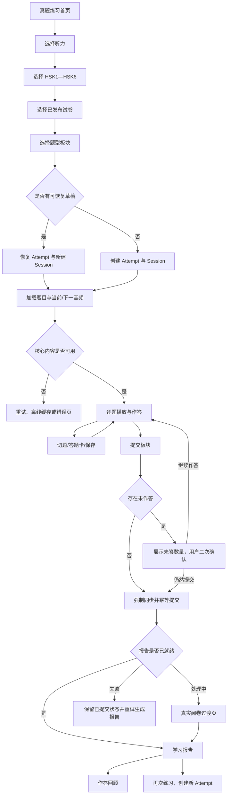
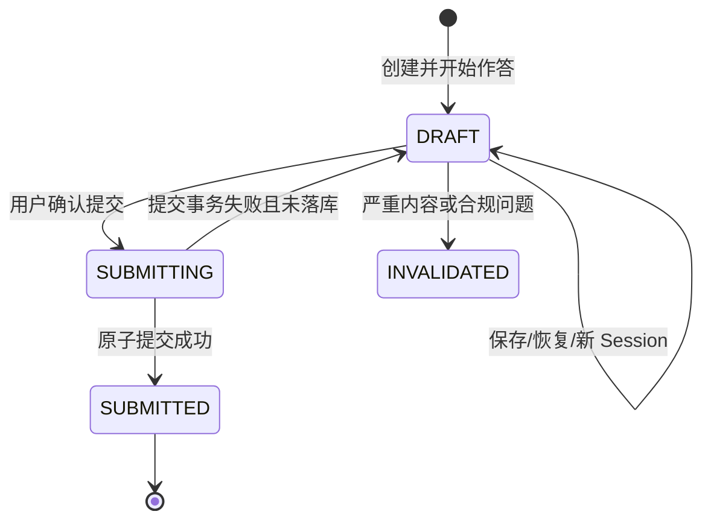

# 汉考宝 iOS 端—真题练习—听力模块 PRD

> 文档状态：评审中  
> 编写人：蒙蘅辉  
> 当前版本：v1.2.0  
> 编写日期：2026-07-23  
> 适用端：汉考宝 iOS App（Flutter 页面与 iOS 原生媒体能力协作）

---

## 0. 文档信息

| 项目 | 内容 |
|---|---|
| 产品名称 | 汉考宝中文学习系统 |
| 所属模块 | iOS 端 → 真题练习 → 听力模块 |
| 需求类型 | 新增模块 / 与阅读、写作通用能力对齐 |
| 需求状态 | 评审中 |
| 页面方案版本 | `hsk_ios_listening_prototype_v7.html` |

### 0.1 版本记录

| 版本 | 日期 | 编写人 | 变更说明 |
|---|---|---|---|
| v1.2.0 | 2026-07-23 | 蒙蘅辉 | 依据《新版 HSK（1—6级）考试结构与样题示例》校正六个等级的听力板块、题量和建议时长；明确每题自动播放序列只触发一次但手动播放不限次数；材料题采用“材料音频→题目音频”顺序及暂停中断规则；删除共享材料分组业务单元；合并报告中的错误与未作答；补充六类单题回顾映射与页面截图 |
| v1.1.0 | 2026-07-23 | 蒙蘅辉 | 对齐 v7 页面方案：新增答题页 1×/0.5× 播放速度；明确报告单题回顾的“标题—题干—材料—选项—解析”结构；完善 HSK6 第三部分多题共享短文材料时的一题一页、切题和计数规则 |
| v1.0.2 | 2026-07-21 | 蒙蘅辉 | 调整为正式需求文档措辞；删除音频文字稿、字幕和译文的展示与下发能力；消除媒体异常提交、自动播放等歧义 |
| v1.0.1 | 2026-07-21 | 蒙蘅辉 | 新增 HSK1—HSK6 各级不同题型的答题界面说明与 15 张页面示意图，补充组件复用、响应式和内容溢出规则 |
| v1.0.0 | 2026-07-21 | 蒙蘅辉 | 形成听力模块首版完整需求；明确不包含精听、练习不限播放次数、板块提交和报告快照规则 |

### 0.2 适用规则

本 PRD 是听力模块当前版本的产品实现与验收依据，适用规则如下：

1. 页面展示、题型板块、计分题量和素材关系以题库/CMS 审核发布的不可变内容版本为准；
2. Attempt、Session、Answer、Report、保存、提交、幂等和快照复用真题练习已有通用业务语义；
3. 页面示意图用于说明布局和交互，不定义正式题量、题目内容、素材数量或评分答案；
4. 已发布内容与客户端能力不兼容时必须阻断发布并进入产品与内容评审，不得由客户端自行兼容或降级为其他题型。

若某套已审核真题的板块数、计分题量、图片候选或音频分段方式与页面示例不同，客户端必须按该试卷发布快照渲染；不得为了适配页面示例而复制、合并、拆散或丢弃计分题。

### 0.3 术语

| 术语 | 业务含义 |
|---|---|
| 试卷 Paper | 某等级下的一套已发布真题或授权模拟真题 |
| 题型板块 Part | 试卷内可独立进入、保存、提交和生成报告的练习单元 |
| 计分题 Scoring Item | 独立作答、独立判分的最小业务单元；页面一题展示一个计分题 |
| 材料引用 Material Reference | 某道计分题对材料音频、题目音频、图片或选项资源的稳定引用；不同题可引用同一资源，但业务上仍分别作为独立题目处理 |
| Attempt | 用户对“某试卷版本中的某一题型板块”发起的一次完整作答 |
| Session | Attempt 中一次前台有效作答时段；退出、切后台后可结束，恢复后新建 Session |
| Answer | 某 Attempt 下某计分题的当前作答及其版本 |
| Report | Attempt 成功提交后形成的不可变学习报告快照 |
| 内容快照 | 提交时绑定的试卷、板块、题目、选项、图片、音频、评分规则等版本集合 |
| 播放速度 | 答题页提供的 1×/0.5× 基础播放设置；不等同于精听、逐句定位或播放次数限制 |

### 0.4 关键业务口径

| 决策项 | 最终口径 |
|---|---|
| 精听 | 本期不做精听入口、逐句定位、AB 循环、听写、字幕或译文；答题页的 1×/0.5× 仅属于真题练习基础播放设置 |
| 页面与内容 | 页面示意只定义布局和交互；正式内容以审核发布的题目版本为准 |
| 题目页面 | 一道计分题一页；每题独立作答、保存、切题和判分，可通过稳定资源引用复用同一材料 |
| 自动与手动播放 | 每题的自动播放序列在当前 Attempt 中只触发一次；用户手动播放、暂停和重播不限次数，不设置次数额度、剩余次数或次数用尽状态 |
| 播放速度 | 答题页支持 1×与 0.5×；设置仅保存在同一设备当前 Attempt 的本地偏好中，不进入 Answer 或 Report；其他 Attempt 默认 1× |
| 提交与反馈 | 按题型板块统一提交，答题中不逐题展示正确答案 |
| 音频文本 | 音频文字稿、字幕和译文不属于本模块，任何页面均不展示，客户端接口也不下发 |

---

## 1. 需求概述

### 1.1 背景

汉考宝已建设真题练习的阅读、写作模块，需要补齐 iOS 端听力练习能力。听力与阅读相比多出媒体预加载、系统音频中断、资源版本绑定、弱网缓存和防答案泄露等要求；与写作相比，评分为确定性客观题，但同样需要复用草稿恢复、顺序控制、幂等提交和报告快照能力。

现有交互方案已覆盖“等级—试卷—题型—答题—答题卡—提交—报告”的主要页面。页面中的演示题量、素材和答案不属于正式业务数据，正式实现必须读取审核发布的内容版本。

### 1.2 产品目标

- 支持 HSK1—HSK6 听力真题按试卷、按题型板块练习。
- 提供稳定、可恢复、弱网可用且不泄露标准答案的听力作答流程。
- 每题首次进入时自动触发一次规定的播放序列，同时允许用户不限次数手动播放，并保留清晰的媒体状态和系统中断处理。
- 支持未完成提交、确定性自动阅卷、学习报告和提交后作答回顾。
- 与阅读/写作共用 Attempt、Session、Answer、Report 等业务语义，降低跨模块理解和维护成本。
- 为运营和题库人员提供可发布、可追溯、可审计的内容版本规则。

### 1.3 本期不包含

本期明确不包含：

- 精听模块、逐句跟读、逐句循环、AB 循环、听写、译文切换，以及 1×/0.5× 之外的多档播放速度；
- 模拟考试或正式考试中的强制单向播放、播放次数限制、禁止暂停等考场规则；
- 答题中逐题显示正确答案或“每题查看答案”；
- 主观语音评分、发音评分或生成式 AI 评价；
- CMS 大型重构、数据库表名统一或强制修改现有 Java/Flutter 内部模型名称；
- Android、Web 端页面交付。

### 1.4 上线观察指标

首版上线后按版本监控：板块启动成功率、音频首播成功率、音频加载 P95、草稿保存成功率、恢复成功率、提交成功率、重复提交去重率、报告生成成功率、媒体错误率、异常退出恢复率。具体阈值见第 15 章。

---

## 2. 用户与使用场景

| 用户 | 核心需求 | 典型场景 |
|---|---|---|
| HSK 学习者 | 按等级和真题板块训练听力 | 通勤、宿舍或教室内使用耳机练习 |
| 重复练习用户 | 对已做板块重新练习并对比表现 | 从历史报告或题型页发起新 Attempt |
| 弱网用户 | 避免因网络波动丢失答案和进度 | 音频已缓存时离线继续作答，联网后同步 |
| 题库/CMS 运营 | 发布题目与音频并保证绑定正确 | 校验题量、选项、答案、音频版本后原子发布 |
| 测试与客服 | 定位用户作答、媒体和报告问题 | 通过非敏感追踪标识和版本信息复现问题 |

### 2.1 典型用户故事

- 作为学习者，我选择 HSK6 的一套真题和第三部分，等待音频就绪后逐题作答，随时打开答题卡检查未答题。
- 作为学习者，我可以暂停或重新播放音频，不受次数限制；但离开当前题后不会同时播放上一题音频。
- 作为学习者，我可以在答题页将音频切换为 0.5×；选择后同一设备、当前 Attempt 后续的材料音频和题目音频继续按 0.5×播放，直至我切回 1×或结束该次练习。
- 作为学习者，我临时退出后再次进入，可以恢复到上次题号、答案和累计有效作答时长。
- 作为学习者，即使有未答题也可以提交，但提交前必须明确看到未答数量；提交后未答题按错误处理，学习报告不再单列未作答结果。
- 作为运营，我修改题目或音频时必须发布新版本，旧草稿和旧报告仍按原版本可回看。

---

## 3. 全局通用业务规则

### 3.1 练习粒度

- 最小进入、保存、退出、提交和报告单元为“题型板块 Part”。
- 一个 Attempt 只绑定一个用户、一个 `syllabusVersion`、一个 `paperId/paperVersion`、一个 `partId/partVersion` 和一个不可变 `questionSetVersion`。
- UI 一页展示一个计分题。不同计分题可引用同一材料资源，但不存在额外的材料级作答、切题、计数或报告单元。
- 同一板块提交后，再次练习创建新 Attempt；不得覆盖既有 Report。

### 3.2 状态与恢复入口

进入题型板块时：

1. 无草稿、无进行中 Attempt：创建新 Attempt；
2. 存在当前用户、当前内容版本的可恢复草稿：恢复答案、当前题号和累计有效时长；同一设备若仍保留该 Attempt 的本地播放速度偏好则一并恢复，不恢复音频播放位置；
3. 只有已提交历史：创建新 Attempt，历史报告保持不变；
4. 草稿内容版本已下架但仍允许历史恢复：按原快照只读加载内容并继续；
5. 草稿因严重内容问题被禁止继续：提示原因，保留审计记录，不自动迁移答案到新版本。

恢复时展示一次轻提示“已恢复上次练习进度”。不得因恢复失败静默创建新 Attempt 并覆盖本地草稿。

### 3.3 时间规则

- 页面显示正向累计“有效作答时长”，建议时间仅作参考，不倒计时、不自动交卷。
- 有效时长只累计 App 前台、练习页可交互且 Attempt 未提交的时间。
- 切后台、锁屏、系统来电、长时间系统遮挡、退出练习页、音频权限或系统中断导致不可交互时暂停计时。
- 恢复后建立新 Session，并在原 Attempt 的累计有效时长上继续。
- 客户端可展示本地估算值；服务端以合法 Session 汇总和提交快照为准，并允许合理时钟偏差。

### 3.4 答案与正确答案隔离

- 作答阶段客户端只接收渲染与作答所需内容，不得接收标准答案、正确选项标识、评分规则明细、解析或任何 `evaluator-only` 数据。
- 正确答案只存在于受控的服务端评价域或等价受保护服务中。
- 选项顺序必须以提交快照中的稳定 `optionId` 判分，不使用显示字母、中文文案、数组下标或当前排序号。
- 客户端包、日志、埋点、错误上报、缓存明文中不得出现标准答案。

### 3.5 页面示意与内容数据

- 页面示例中的试卷编号、演示题量、正确答案、语音合成文本和存储逻辑均不进入正式业务口径。
- 正式客户端按发布清单渲染真实题目；首版等级配置仅用于产品基线和 CMS 校验模板。
- 任何题型中文名只用于展示，跨端逻辑必须使用稳定 `questionTypeId` 或能力枚举。

---

## 4. 等级、试卷、题型与题量规则

### 4.1 等级范围

HSK1—HSK6 均提供听力科目入口。若某等级当前没有可用试卷，等级入口可见但显示空状态；不得跳转到其他等级或用模拟数据占位。

### 4.2 初始产品配置基线

下表为首版 `syllabusVersion` 的计分题配置基线和建议时长，用于产品展示、CMS 校验模板和测试基线。某套实际试卷经内容审核确认存在差异时，以该套试卷已发布快照为准，并须在发布前完成产品/内容评审。

| 等级 | 建议时长 | 基准计分题量 | 基准板块计分题量 | 题型配置（展示文案可配置） |
|---|---:|---:|---|---|
| HSK1 | 约 12 分钟 | 20 | 5 + 5 + 5 + 5 | 看图选择（词语/短语）、看图选择（问句）、图片匹配（对话）、细节选择（短文问答） |
| HSK2 | 约 17 分钟 | 25 | 5 + 10 + 10 | 看图选择、图片匹配（对话）、细节选择（对话问答） |
| HSK3 | 约 23 分钟 | 30 | 10 + 10 + 10 | 图片匹配、对话选择、短文选择 |
| HSK4 | 约 20 分钟 | 32 | 14 + 18 | 对话选择、短文选择 |
| HSK5 | 约 25 分钟 | 35 | 19 + 16 | 对话/材料选择、短文选择 |
| HSK6 | 约 30 分钟 | 40 | 8 + 20 + 12 | 短文选择、短文选择、访谈选择 |

说明：

- 上表来源为《新版 HSK（1—6级）考试结构与样题示例》，统计的是计分题，不是页面数或音频段数。
- 真题练习模式不设置播放次数限制，任何页面均不展示已播放次数、剩余次数或播放遍数。
- 题型名称、板块顺序、题目数量均来自版本化配置；客户端不得写死 HSK 等级与数组位置的映射。

### 4.3 试卷与进度

- 每个等级展示 CMS 已发布且对当前用户地区/权限可见的试卷。
- 试卷卡显示试卷名称或编号、板块完成情况、计分题完成进度和状态：未开始、练习中、已完成。
- “已完成 X/Y”中的 Y 为该试卷发布快照的计分题总数；X 为各板块至少存在一次成功提交 Report 所覆盖的计分题数，重复练习不重复累加。
- 板块成功提交后，该板块全部计分题计入试卷完成进度；其中未作答题不影响“已完成”进度，但在报告中统一按错误统计。
- 草稿可使试卷状态变为“练习中”，但不计入已完成题数。
- 已完成试卷允许重复练习。试卷卡默认展示最新有效进度，历史 Attempt/Report 在学习记录中保留。

### 4.4 一题一页与材料引用

- UI 采用“一道计分题一页”。
- 每个页面必须定位一个稳定 `questionId`，并携带本题所需的题干、材料音频、题目音频、图片、选项及版本引用。
- 当原始试卷中多道题使用同一段短文或访谈时，每道题仍按独立题目发布和展示；多个 `questionId` 可以引用同一稳定材料音频资源，但客户端不展示材料内子进度，也不存在额外的材料内切题业务。
- 图片匹配等题型的每道题都独立提交一个选项答案。若真实题目存在选项复用限制，应在题目级可机器读取规则中声明；不得依赖中文题型名称、数组下标或页面顺序推导。
- 页面总进度、答题卡、已答数、未答数、提交和报告统计均按计分题数量计算，不按材料段数计算。

---

## 5. 完整业务流程



### 5.1 Attempt 生命周期



- `SUBMITTED` 为终态，不允许继续修改答案。
- 网络超时不能据此判定提交失败；客户端必须使用同一 `Idempotency-Key` 查询或重试，直到得到确定结果。
- `INVALIDATED` 只用于严重内容、版权、安全或数据完整性问题，不作为普通版本升级手段。

---

## 6. 页面与功能详细说明

### 6.1 听力试卷选择页


> 图 1：试卷选择页面示意。图中试卷编号和进度为示例数据，正式页面读取已发布内容版本。

| 区域 | 展示/交互 | 规则 |
|---|---|---|
| 导航栏 | 返回、备考说明 | 返回真题练习首页；备考说明展示当前 `syllabusVersion` 的说明文本 |
| 等级标签 | HSK1—HSK6 横向选择 | 切换后刷新该等级试卷；保留当前等级用于下次进入，但不得覆盖深链指定等级 |
| 试卷卡 | 编号/名称、状态、完成进度 | 仅展示已发布可见版本；点击进入题型板块页 |
| 空状态 | 暂无可练习试卷 | 提供返回；可配置“稍后再来”，不展示假试卷 |
| 加载状态 | 骨架屏 | 首屏超过 10 秒仍未完成时转为可重试错误态 |

### 6.2 备考说明页

- 展示当前等级的建议时间、基准题量、题型说明和来源/版权说明。
- 不展示已播放次数、剩余次数或播放遍数。
- 文案随 `syllabusVersion` 版本化；历史报告展示提交时版本，不强制替换为最新说明。

### 6.3 题型板块选择页

| 内容 | 规则 |
|---|---|
| 板块列表 | 按发布快照排序，显示名称、计分题数、建议时间（若有）、状态 |
| 草稿板块 | 显示“继续练习”和已答/总题数；点击后恢复原 Attempt |
| 已完成板块 | 显示最近一次正确数/总数及“学习报告”；仍可“再次练习” |
| 未开始板块 | 点击后创建 Attempt；创建失败不得进入空白答题页 |
| 异常板块 | 内容下架或版本不可用时置灰并说明，不自动改绑其他版本 |

### 6.4 答题页

| 默认 1× | 已选择 0.5× |
|---|---|
|  |  |

> 图 2A—2B：答题页默认速度与 0.5× 状态示意。右上角必须明确显示当前速度；正式页面须包含真实媒体状态、弱网提示和无障碍语义。

| 区域 | 功能 | 详细规则 |
|---|---|---|
| 顶部导航 | 退出、有效时长、题型名、播放速度、答题卡 | 退出触发保存；速度按钮在 1×/0.5×之间切换；答题卡打开时暂停音频 |
| 题目说明 | 当前板块作答说明 | 来自 `partVersion`，不得用客户端固定文案替代 |
| 题目主体 | 题号、题干、图片/文字、引用素材 | 一页一个计分题；按稳定资源引用渲染 |
| 音频播放器 | 播放/暂停、进度、状态 | 练习不限播放次数；进度条仅展示，不支持拖动定位 |
| 选项区 | 判断、文字单选或图片选项 | 选择即更新本地 Answer；不显示对错 |
| 底部导航 | 上一题、题号进度、下一题 | 边界按钮置灰；切题先保存并按媒体规则停止当前播放 |

作答阶段不得显示正确答案、答案颜色反馈、解析、音频文字稿、字幕、译文、逐句文本或“每题查看答案”。

播放速度是同一设备当前 Attempt 的本地播放偏好，不是题目内容、Answer、Report 或评分条件。选中 0.5× 后，当前 Attempt 后续进入的普通题音频、材料音频和题目音频均使用 0.5×；具体切换、保存、恢复及系统中断规则见第 8.2 节。

### 6.5 HSK1—HSK6 不同题型答题界面

本节页面示意图只用于说明题目主体、音频播放器和选项区的页面形态。图中的题干、题型名、板块数、选项数、题号进度和演示答案不是正式内容；正式 App 必须按已发布题目快照渲染。等级板块和题量以第 4.2 节及实际审核发布试卷为准。

#### 6.5.1 题型界面组件总表

| 界面组件 | 页面主体 | 作答控件 | 新版 HSK 基线适用范围 |
|---|---|---|---|
| 看图选择 | 当前题音频、图片选项宫格 | 点击一张图片作为答案 | HSK1 第一/二部分、HSK2 第一部分 |
| 图片匹配 | 当前题音频、图片选项列表或抽屉 | 从本题候选图片中选择一个答案 | HSK1 第三部分、HSK2 第二部分、HSK3 第一部分 |
| 文字单选 | 当前题音频、文字选项列表 | 单选；选项数量由题目快照决定 | HSK1 第四部分、HSK2 第三部分、HSK3 第二/三部分、HSK4—HSK6 |
| 材料与题目双播放器 | 题干/作答指令、材料音频、题目音频（若有）、文字选项 | 每题独立单选 | 短文、材料、访谈等实际题目同时配置材料音频与题目音频时 |
| 看图判断、文字判断 | v7 原型中已有的判断题页面能力 | “正确/错误”两个判断按钮 | 不作为第 4.2 节新版 HSK 基线板块；仅在真实已审核题目明确配置且通过产品评审时启用 |

通用要求：

- 顶部均显示有效作答时长、题型名称、当前播放速度和答题卡入口；底部均显示上一题、当前题号/总题数和下一题。
- 播放器、保存、切题、暂停、中断和不限次数重播规则统一遵循第 8 章。
- 页面不根据等级名称选择组件，而根据稳定 `questionTypeId`、题目级资源角色和发布快照中的渲染能力选择组件。
- 同一题型在不同等级可以有不同题干长度、图片数量、选项数量和音频长度；客户端不得根据页面示意图反推固定数据限制。

#### 6.5.2 HSK1

HSK1 共四部分：第一、二部分使用看图选择组件，第三部分使用图片匹配组件，第四部分使用文字单选组件。第一、二部分虽然作答指令和音频内容不同，但均由用户从图片选项中选择答案。

| 第一/二部分：看图选择 | 第三部分：图片匹配 |
|---|---|
|  |  |
| 音频下方展示图片选项宫格；选项字母与图片均应具有可访问标签。 | 图片选项可在抽屉或列表中展示；每页仍只对应一道计分题。 |

第四部分：细节选择


音频下方展示文字单选项。示例中的拼音属于题目内容；是否显示由已发布题目决定。

> 图 3—5：HSK1 答题页面组件示意。

#### 6.5.3 HSK2

HSK2 共三部分：第一部分为看图选择，第二部分为图片匹配，第三部分为文字单选。

| 第一部分：看图选择 | 第二部分：图片匹配 |
|---|---|
|  |  |
| 从当前题的图片选项中单选。 | 音频与图片候选区分区展示，图片选项可滚动；每题答案独立保存。 |

第三部分：细节选择


短对话音频配文字单选列表；选项数量以实际题目为准。

> 图 6—8：HSK2 三部分答题页面组件示意。

#### 6.5.4 HSK3

HSK3 共三部分：第一部分为图片匹配；第二部分为对话选择；第三部分为短文选择。第二、三部分复用文字单选组件，但音频角色、时长及题干内容分别来自真实题目。

| 第一部分：图片匹配 | 第二/三部分：文字单选 |
|---|---|
|  |  |
| 当前计分题显示音频和图片候选区；本题引用的资源用稳定标识绑定。 | 对话或短文音频下方展示文字单选项；较长选项应自适应高度。 |

> 图 9—10：HSK3 答题页面组件示意。

#### 6.5.5 HSK4

HSK4 共两部分：第一部分为对话选择，第二部分为短文选择，均使用文字单选组件。第二部分若原题为一段材料对应多道题，每一道题仍单独占一页，并在本题内先显示材料再显示题目。


> 图 11：HSK4 文字单选页面组件示意；正式题型、题量和音频角色以题目快照为准。

#### 6.5.6 HSK5

HSK5 共两部分：第一部分为对话/材料选择，第二部分为短文选择，均使用文字单选组件。页面框架相同，差异来自实际材料、问题音频、题干和选项内容。


> 图 12：HSK5 文字单选页面组件示意。较长选项采用多行自适应卡片；不得缩小字号以强行保持单行。

#### 6.5.7 HSK6

HSK6 共三部分：第一、二部分为短文选择，第三部分为访谈选择。三部分均为每题独立的文字单选；是否同时存在材料音频和题目音频由该题的发布快照决定。

| 第一部分：短文选择 | 第二/三部分：材料/访谈选择 |
|---|---|
|  |  |
| 当前题绑定短文或相应音频片段，展示文字单选项。 | 页面按“题干—材料音频—题目音频（若有）—选项”展示；原型中的“材料 N”等文案只作 UI 参考，正式页面不展示材料内子进度。 |

> 图 13—14：HSK6 两类播放器组合示意。

材料类题目详细规则：

1. 每一道计分题均为独立题目，具有独立 `questionId`、题干、选项和答案；不存在额外的材料级作答状态或材料内序号。
2. 多道独立题可以引用同一稳定材料音频资源。复用资源不等于复用播放状态；进入每道题时均按本题自动播放规则处理。
3. 页面内先展示材料，再展示本题题目。若材料内容已作为题干卡的一部分呈现，不要求额外增加“材料”标题，但材料音频、图片和题目音频的视觉顺序不得颠倒。
4. 页面底部进度、答题卡和报告题号只使用整板块计分题序号，不显示 `1/2` 等材料内子进度。
5. 点击上一题、下一题或答题卡题号时，停止并归零离开页面的全部音频；新题按第 8.3 节判断是否触发一次自动播放序列。
6. 内容关系至少能表达稳定 `questionId`、材料音频 `materialAudioSegmentRef`（若有）、题目音频 `questionAudioSegmentRef`（若有）、图片资源及选项标识；不得使用“第几部分”、中文材料标题或当前位置判断跨端逻辑。

#### 6.5.8 响应式与内容溢出规则

- 题目主体优先完整显示，底部导航固定但不得覆盖图片、选项或图片候选抽屉。
- 文字选项允许多行并自适应高度；超出一屏时滚动题目内容，不能横向截断。
- 图片按内容给定的宽高比等比缩放，不拉伸、不裁掉影响作答的信息。
- 图片选择宫格列数按屏幕宽度和图片最小可辨识尺寸自适应，不得固定为 2×2。
- 图片匹配抽屉应有可见拖动提示、展开/收起状态和 VoiceOver 操作；抽屉移动不改变已选答案。
- 动态字体、不同语言 UI 文案和刘海/灵动岛安全区下，答题卡、播放器、选项和底部按钮均不得缺边。

### 6.6 答题卡


> 图 15：答题卡页面示意。打开答题卡时须暂停当前音频。

| 状态 | 视觉规则 | 点击行为 |
|---|---|---|
| 已作答 | 品牌主色实心或有明确已答标识 | 关闭答题卡并跳转该题 |
| 未作答 | 中性灰/空心 | 关闭答题卡并跳转该题 |
| 当前题 | 清晰描边，不能只靠颜色 | 保持当前题并关闭答题卡 |

- 顶部显示已答数/总计分题数。
- 提交按钮始终可用；存在未答题时先显示未答数量和二次确认。
- 答题卡属于可交互作答流程，打开期间继续累计有效作答时长；打开瞬间暂停当前音频。
- 关闭答题卡后不自动恢复音频，用户主动点击播放，避免突然出声。

### 6.7 退出确认

点击返回、关闭或手势退出时：

- 立即暂停音频并停止有效时长累计；
- 触发本地强制保存并尝试同步服务端；
- 弹窗文案统一表达“退出后将保留当前进度”；按钮为“继续练习”“退出”；
- 用户选择“继续练习”后，页面恢复可交互时继续累计有效时长；音频保持暂停，由用户主动播放；
- 网络不可用时允许退出，明确提示“进度已保存在本机，联网后自动同步”；
- 退出不清空 Attempt，不再区分容易误解的“退出”和“保存并退出”两种业务结果。

### 6.8 提交确认与阅卷过渡

- 打开提交确认弹窗时立即暂停当前音频并暂停有效作答时长累计。
- 无未答题：确认文案“提交后不能修改答案，是否提交？”
- 有未答题：明确显示“还有 N 题未作答。提交后未作答将计入错误统计，且不能修改。”
- 用户可选择“继续作答”或“仍然提交”。
- 用户选择“继续作答”后，页面恢复可交互时继续累计有效时长；音频保持暂停，由用户主动播放。
- 提交开始后禁用重复点击，但允许同一幂等请求安全重试。
- 提交成功且 Report 已为 `READY` 时直接进入学习报告；Report 为 `PROCESSING` 时展示真实阅卷状态，不得使用固定动画或固定时长伪造等待。
- 报告生成失败不回滚已成功提交的 Attempt，进入可重试报告页并由可靠任务补偿。

### 6.9 学习报告


> 图 16：学习报告页面示意。正式报告必须来自提交快照，不能使用页面示例答案。

报告至少展示：

- 等级、试卷、题型板块、提交时间；
- 正确率、正确数、错误数、计分题总数；其中错误数 = 计分题总数 - 正确数；
- 累计有效作答时长；
- 题号矩阵和图例；
- 再次练习入口；
- 作答回顾入口。

报告只区分“正确”和“错误”两种结果：满分题为正确，未满分题均为错误；未作答题得 0 分并按错误展示，不设置独立的未作答统计、筛选或题号样式。题号状态规则：正确为绿色实心并带对勾；错误为红色实心并带叉；当前查看题增加独立描边。颜色必须配合图形或文字，不能只依赖颜色区分。

### 6.10 作答回顾

- 仅在 Report 为 `READY` 后开放。
- 单题回顾按以下固定层级从上至下展示：

| 顺序 | 区域 | 展示内容与规则 |
|---:|---|---|
| 1 | 标题 | 展示题型名称和整板块计分题号，如“看图判断题 第 1 题”；题号与报告题号矩阵一致 |
| 2 | 题干 | 展示提交快照中的作答指令、陈述或可显示的问题文本。材料可以与题干处于同一卡片内；只要真实题目有题干内容就必须完整显示，不得因页面布局把题干隐藏或留空 |
| 3 | 材料 | 展示本题作答所依据的音频和图片。存在材料音频与题目音频时，先显示材料音频，再显示题目音频；图片按内容角色显示在相应位置。音频不转写为文字 |
| 4 | 选项 | 按提交时显示顺序展示全部选项，并标注用户所选和正确答案。题级结果只显示正确/错误；用户未选择时可在答案说明中显示“你的答案：未选择”，但题号和汇总仍按错误处理 |
| 5 | 解析 | 展示提交时已审核发布的解析；没有可用解析时显示“暂无解析”，不得省略区域或即时生成解释 |

- 展示提交快照中的题目、用户答案、正确答案、正确/错误结果和已审核解析。
- 音频文字稿、字幕和译文在作答回顾中也不展示，客户端接口不下发相关数据。
- 回顾音频允许播放、暂停和不限次数重播。回顾页当前不提供速度入口，播放速度固定为 1×，不得隐式继承答题页的 0.5×状态；仍不提供精听、逐句或译文切换。
- 历史回顾必须使用该 Report 的快照，即使 CMS 后续修订题目也不静默改变历史内容。
- 单题回顾不提供上一题、下一题或题号切换入口。用户点击关闭后返回学习报告，并恢复打开回顾前的报告滚动位置。

#### 6.10.1 题型—题干—材料—选项回顾映射

下表描述的是页面结构映射，不用中文题型名称驱动客户端逻辑。客户端应按稳定 `questionTypeId` 及题目快照中的资源角色渲染。

| 题型/组件 | 题干 | 材料 | 选项 |
|---|---|---|---|
| 看图判断 | 作答指令 | 题目音频 + 单张题目图片 | “正确/错误”两个稳定选项 |
| 看图选择 | 作答指令 | 题目音频 | 图片选项宫格；图片属于选项，不重复放入材料区 |
| 图片匹配 | 作答指令 | 题目音频 | 当前题全部候选图片；每题答案独立，不展示额外材料内进度 |
| 文字判断 | 作答指令 + 待判断陈述 | 题目音频 | “正确/错误”两个稳定选项 |
| 细节/对话选择 | 作答指令或可显示问题文本 | 题目音频；若另有题目图片则一并显示 | 文字单选项 |
| 短文/材料/访谈选择 | 作答指令、问题文本或题干内材料说明 | 材料音频 → 题目音频（若有）→ 图片（若有） | 文字单选项；每题独立回顾 |

#### 6.10.2 六类单题回顾页面示意

| 看图判断 | 看图选择 | 图片匹配 |
|---|---|---|
|  |  |  |

| 文字判断 | 细节选择 | 短文/材料选择 |
|---|---|---|
|  |  |  |

> 图 17—22：v7 原型的六类单题回顾页面示意。截图只作为布局与信息层级参考；截图中的演示题型、演示答案、“未作答”提示和解析文案均不定义正式业务规则。正式页面必须按本 PRD 与 Report 提交快照展示。

---

## 7. 答题、保存、恢复、退出与提交

### 7.1 答案规则

- 首版题型为确定性客观题，包括判断、文字单选和图片单选。
- Answer 存储稳定 `questionId` 与 `selectedOptionId`；判断题同样使用稳定选项标识，不直接依赖“正确/错误”中文文案。
- 允许修改未提交答案；最后一个合法 `clientSequence` 对应的已接受答案为当前答案。
- 选项乱序时，提交的是选项稳定标识，显示字母仅为当前快照的派生展示。
- 每一道计分题的答案独立保存。图片匹配等题型也不得通过其他题的已选答案隐式推导当前题答案。

### 7.2 保存策略

- 答案变化先立即写入内存并写入受保护的本地草稿，然后以 500—1000ms 防抖同步服务端。
- 以下节点必须强制保存：切题、打开答题卡、关闭答题卡、退出弹窗、切后台、锁屏前可感知事件、网络恢复、提交前。
- 服务端暂时失败不得清除本地草稿；本地与服务端保存状态应有非打扰式提示。
- 本地草稿应使用平台安全存储或等价受保护方案；具体加密实现由客户端评审决定。

### 7.3 顺序与冲突语义

- `clientSequence` 表示同一客户端对 Attempt 的单调递增变更序列，用于去重和拒绝乱序覆盖。
- `baseVersion` 表示客户端修改基于的服务端草稿版本，用于检测多端或多会话并发冲突。
- 服务端不得仅按设备时间“最后写入者获胜”。
- 同设备旧序列重放：幂等返回当前已接受结果；不同设备冲突：返回冲突摘要，客户端提示用户选择保留本机或云端版本，再以明确的新版本提交。
- 冲突解决不得自动合并为一个题目包含多个互斥答案的无效状态。

### 7.4 恢复规则

服务端草稿恢复内容包括：Attempt 标识、绑定内容版本、当前题号、全部当前答案、累计有效时长、最后一次有效 Session 信息和必要的已缓存媒体清单。同一设备可以另外按 `attemptId` 恢复本地播放速度偏好；该偏好不属于服务端草稿、Answer 或 Report。

恢复不包括：上次音频精确播放位置、自动继续播放状态、未提交的播放器临时 UI。恢复后音频处于就绪/暂停状态，由用户主动播放；同一设备仍保留该 Attempt 的 0.5× 偏好时，页面速度按钮同步显示 0.5×，否则显示 1×。

### 7.5 提交事务

提交请求必须同时具备稳定 `attemptId` 和 `Idempotency-Key`。服务端在单一业务事务或等价原子边界内完成：

1. 校验用户与 Attempt 归属、Attempt 状态和内容版本可用性；
2. 接收并确认提交前最后一批答案与版本；
3. 固化答案、题目与评分规则快照引用；
4. 将 Attempt 置为 `SUBMITTED` 并记录提交时间、有效时长；
5. 创建唯一 Report 骨架；
6. 完成确定性评分，或投递可可靠重试的评价事件。

任一步骤在提交原子边界内失败，不得留下“Attempt 已提交但无可定位 Report”的孤立状态。异步评分失败时，Report 可保持 `PROCESSING/FAILED_RETRYABLE`，但 Attempt 的成功提交事实不回滚。

相同 `Idempotency-Key + attemptId` 的重复请求必须返回同一提交结果和 `reportId`；不同幂等键对已提交 Attempt 再次提交也不得生成第二份 Report。

---

## 8. 音频播放与媒体控制规则

### 8.1 产品口径

- 本模块是真题练习，不设置播放次数限制，不展示已播放次数、剩余次数或次数用尽状态。
- 播放业务单元为当前计分题引用的稳定音频片段。一个音频资源可被一道或多道独立题目引用，但不会因为页面是一题一页而复制成不同业务资源。
- 若版权方只提供一条整卷或整板块连续音频，题库发布时必须提供经审核的题目片段映射或可独立播放的派生片段；客户端不得靠数组下标或估算时间自行切割。
- 支持播放、暂停、从头重播；播放完成后再次点击即从头播放。
- 进度条只显示当前时间/总时长，不支持拖动或点击跳转，避免与精听能力混淆。
- 答题页支持 1×与 0.5×两档播放速度；不支持其他速度、AB 循环、逐句定位、字幕跟随或后台连续播放。
- 每个媒体播放器的总时长始终显示源音频媒体时长。0.5× 只使当前播放进度按较慢速度推进，不把总时长显示为两倍。

### 8.2 播放速度

- 速度按钮位于答题页右上角，显示当前状态“1×”或“0.5×”；点击后在两档之间切换，选中态同时使用文字和视觉状态表达。
- 新建 Attempt 默认 1×。用户选择 0.5×后，该 Attempt 后续的普通题音频、材料音频和题目音频均按 0.5×播放；切题、打开并关闭答题卡或弹窗不重置速度。
- 播放速度仅作为同一设备按 `attemptId` 保存的本地偏好，不进入 Answer、Report 或服务端草稿。用户退出当前 Attempt 后打开另一练习，另一 Attempt 仍默认 1×；回到原 Attempt 时，如本地偏好仍存在则恢复 0.5×。更换设备、卸载重装或本地偏好被清理后可回退为 1×。
- 音频正在播放或暂停时切换速度：停止当前播放、位置归零，并从头按新速度重新播放当前音频。切换发生在加载阶段时，将新速度应用于待开始播放的音频，不发起重复播放。
- 速度切换不改变自动播放是否已触发的状态，不影响答案、判分、有效作答时长、资源版本或音频内容摘要。
- 无论 1× 还是 0.5×，播放器总时长均为源音频媒体时长；0.5× 下当前时间按媒体时间轴较慢推进，总时长不翻倍。
- 系统中断后由用户主动继续时，仍使用当前 Attempt 已选速度；旧音频不得以另一速度并发播放。
- 报告单题回顾没有速度入口，统一以 1×播放，不隐式继承 Attempt 的 0.5×，避免页面状态与实际播放速度不一致。
- VoiceOver 标签须包含控件作用和当前值，例如“播放速度，当前 0.5 倍，按钮”。

### 8.3 自动播放

- 每道题在当前 Attempt 中首次到达且核心题目、音频和系统音频会话均就绪后，只触发一次自动播放序列。用户离开后再次返回该题、从草稿恢复、关闭答题卡或关闭弹窗时，均不得再次自动触发。
- 普通题只有题目音频时，自动播放该题目音频一次。
- 材料类题目先自动播放材料音频；只有材料音频自然播放结束，且本次自动序列从未被用户暂停、系统中断、遮挡层暂停或其他播放器替换时，才继续自动播放题目音频一次。
- 用户在材料音频播放过程中点击暂停，该题本次自动序列立即终止；即使之后手动继续并播放完材料，也不再自动播放题目音频，用户可手动播放。
- 若受 iOS 自动播放策略、系统焦点、蓝牙切换或网络状态限制，页面保持明确“点击播放”状态，不重复抢占系统音频焦点。
- 用户主动切到上一题、下一题或答题卡目标题时，停止并归零旧题全部播放器；新题仅在其尚未触发过自动播放序列时触发一次。
- 从答题卡、退出弹窗、后台、锁屏、系统中断或草稿恢复返回答题页时不自动播放，由用户主动恢复。
- “自动播放一次”只描述系统自动触发次数，不是播放次数限制；自动播放完成或被取消后，用户仍可不限次数手动播放任一音频。

### 8.4 切题与遮挡层

| 场景 | 当前音频 | 返回/后续行为 |
|---|---|---|
| 上一题/下一题或答题卡跳题 | 立即停止并归零离开页面的全部播放器 | 新题按第 8.3 节判断是否触发一次自动序列 |
| 材料音频播放时点击题目音频 | 材料音频立即停止并归零 | 题目音频从 0 开始播放；材料到题目的自动串播资格取消 |
| 题目音频播放时点击材料音频 | 题目音频立即停止并归零；材料音频也从 0 开始 | 同一页面任一时刻只能有一个播放器播放 |
| 暂停当前播放器后点击同一播放器 | 保留当前位置 | 从暂停位置继续；若材料曾被暂停，继续完成后也不自动串播题目音频 |
| 点击答题卡 | 暂停并保留位置 | 关闭后保持暂停，用户主动继续 |
| 退出/提交弹窗 | 暂停并保留位置 | 取消弹窗后保持暂停 |
| 提交成功 | 停止并释放当前播放 | 报告页不自动播放 |
| 跳转其他业务页 | 停止 | 返回后按恢复规则处理 |

### 8.5 系统中断

| 中断 | 处理规则 |
|---|---|
| 来电、Siri、闹钟、其他 App 抢占音频焦点 | 立即暂停，记录中断原因；中断结束后不自动播放，提示用户点击继续 |
| 耳机断开或蓝牙输出变化 | 立即暂停，防止声音外放；显示“音频输出已变化” |
| 切后台或锁屏 | 暂停、停止有效计时，不支持锁屏继续播放 |
| 控制中心/系统媒体控制 | 若系统暴露控制，仅允许与页内播放器状态一致的播放/暂停；不得跨题播放 |
| App 被系统终止 | 依赖最近本地草稿恢复；音频位置不恢复 |

### 8.6 音量与耳机提示

- 首次准备播放时，如系统允许可靠判断且媒体音量过低，展示非阻断提示“当前音量较低，请调高媒体音量”。
- iOS 无法可靠判断静音/音量时，不伪造结论；播放器持续无声不能自动判定为资源损坏。
- 未连接耳机只做一次弱提示“建议佩戴耳机获得更好体验”，不得阻断练习。
- 耳机断开必须暂停；连接新输出设备后由用户主动继续。

### 8.7 预加载、缓存与校验

- 进入板块时优先取得题目清单和当前题核心素材；当前题音频可播放后即可进入，不必等待全板块下载完成。
- 客户端可预加载下一题及其引用的材料音频，具体并发和缓存淘汰策略由客户端实现，但不得影响当前题播放。
- 缓存键至少能区分稳定资源标识和资源版本/内容摘要；同一 URL 内容替换不能导致旧缓存误用。
- 音频播放前校验其与 `paperVersion/questionSetVersion/audioVersion` 的绑定；校验失败按资源错误处理，不降级到其他题音频。
- 音频片段、题目、图片和选项必须由同一发布快照显式关联；音频文字稿、字幕和译文不进入客户端内容清单。
- 已完整缓存且版本匹配的音频允许断网播放；未完整缓存不得伪装为可播放。

### 8.8 媒体状态

| 状态 | UI 与行为 |
|---|---|
| IDLE | 尚未请求；显示播放按钮 |
| PRELOADING | 显示加载，不响应重复播放请求；可取消切题 |
| READY | 可播放，显示时长 |
| PLAYING | 播放图标变暂停，进度实时更新 |
| PAUSED | 保留位置，可继续或从头重播 |
| ENDED | 显示“播放完成”，再次播放从头开始 |
| INTERRUPTED | 显示中断原因，用户主动继续 |
| ERROR_RETRYABLE | 显示“音频加载失败，重试”；不影响已填答案 |
| ERROR_FATAL | 提示资源不可用，禁用提交；允许退出并保留草稿，同时上报资源错误 |

### 8.9 超时与失败

- 音频首个可播放数据超过 10 秒仍不可用，转为可重试状态；具体网络层超时参数由技术评审确定。
- 自动重试采用有限次数和退避，不能无限转圈或反复自动出声。
- 音频失败时允许查看题目和已填答案，但不得以文字稿替代音频继续答题。
- 单题核心音频持续不可用时，不允许提交该板块；用户可退出并保留草稿，资源恢复后继续作答。

---

## 9. 自动阅卷、学习报告与作答回顾

### 9.1 判分规则

- 判断、单选、图片单选：提交的稳定选项标识与评分快照的正确选项标识完全一致则得该题分值，否则为错误。
- 每个计分题独立判分。该题获得满分时结果为正确；未获得满分时结果统一为错误。
- 未作答得 0 分，在正确率分母中计入总题数，并统一计入错误数；Report 不产生第三种题级结果。
- 首版不设部分分；若未来出现多选或组合题，必须发布新的评分规则版本并另行评审。
- 首版每个计分题的基准分值为 1 分，实际分值必须随评分规则版本发布；缺少分值或评分规则时 CMS 阻断发布。报告以正确题数/总题数为主要展示，避免与正式考试换算分混淆。

### 9.2 报告状态

| 状态 | 含义 | 用户界面 |
|---|---|---|
| PROCESSING | 提交成功，评分尚未完成 | 真实阅卷过渡，允许安全离开 |
| READY | 报告快照完成 | 展示全部汇总和回顾 |
| FAILED_RETRYABLE | 评价失败但可补偿 | 显示“报告生成中，请稍后重试”，不要求重新答题 |
| FAILED_FINAL | 人工判定无法生成 | 提供客服追踪标识，不暴露内部堆栈 |

### 9.3 报告快照

Report 必须引用或包含提交时的不可变快照：试卷/板块/题目版本、题型标题、可显示题干、题目级材料引用、用户答案、评分规则版本、正确/错误结果、题目顺序、选项显示顺序、材料/题目音频与图片版本、已审核解析、有效时长和提交时间。快照必须足以按第 6.10 节顺序独立还原单题回顾，不得在查看历史报告时拼接当前 CMS 最新内容。

Report 在 `READY` 前只允许处理状态和失败原因发生变化；进入 `READY` 后，题级结果、汇总数据和内容快照均不可修改。

CMS 后续修题不会静默修改历史 Report。若历史报告因合规原因必须撤下素材，应保留得分与审计事实，并在回顾处展示合规占位说明。

### 9.4 历史与重复练习

- 同一用户、同一板块可有多个已提交 Attempt 和多个 Report。
- 题型页默认展示最近一次 `READY` 报告摘要；学习记录保留全部有效历史。
- 再次练习创建新 Attempt，初始答案为空，计时从 0 开始，可复用已验证媒体缓存。
- 试卷完成进度按板块是否至少成功提交一次计算，不因重复练习超过总题数。
- 报告比较、趋势图不在本期范围，但数据结构不得阻止后续按版本正确比较。

---

## 10. 异常状态与降级策略

| 场景 | 用户表现 | 业务处理 | 是否保留答案 |
|---|---|---|---|
| 等级无试卷 | 空状态 | 不创建 Attempt | 不适用 |
| 试卷列表失败 | 错误页+重试 | 展示上次成功缓存的列表并标记“离线数据”；仅已完整缓存且版本校验通过的板块可进入，其余入口置灰 | 是 |
| Attempt 创建失败 | 明确失败+重试 | 不进入答题页 | 不适用 |
| 题目清单缺失/数量不符 | 内容不可用 | 阻止开始，上报内容校验错误 | 不适用 |
| 图片失败 | 占位+重试 | 图片是核心题干时阻止有效作答；非核心装饰可降级 | 是 |
| 音频缓慢 | 加载态，10 秒后可重试 | 有匹配缓存则使用，否则保持错误态 | 是 |
| 音频 404/摘要不符 | 资源不可用 | 禁止错配其他资源，记录资源版本 | 是 |
| 播放中断 | 暂停+原因提示 | 中断后用户主动恢复 | 是 |
| 断网但音频已缓存 | 离线提示 | 允许继续，答案进本地队列 | 是 |
| 断网且音频未缓存 | 重试/退出 | 不以文字稿或其他音频替代，不创建虚假播放完成 | 是 |
| 本地保存失败 | 高优先级提示 | 暂停切题、退出和提交，保留当前前台会话内存并要求用户重试 | 当前进程存活期间保留 |
| 服务端保存失败 | 弱提示“待同步” | 本地继续，退避重试 | 是 |
| 多端冲突 | 冲突摘要 | 用户选择本机/云端版本，不按时间静默覆盖 | 两端均保留至解决 |
| 提交超时 | “正在确认提交结果” | 同幂等键查询/重试，禁止创建新 Attempt | 是 |
| 重复提交 | 返回原结果 | 同一 reportId | 已固化 |
| 评价暂时失败 | 报告生成中 | 可靠补偿，可退出后从记录进入 | 已固化 |
| 内容提交后下架 | 历史报告按权限降级 | 保留分数快照，受限素材用说明替代 | 已固化 |
| App 崩溃/被杀 | 下次提示恢复 | 从最近本地/服务端草稿恢复 | 是 |
| 服务维护 | 维护页 | 不清除本地草稿，展示预计恢复信息（若配置） | 是 |

### 10.1 降级原则

1. 不以错误音频、错误图片或旧答案数据“凑合可用”；
2. 不以文字稿替代音频完成答题；
3. 不因网络失败清空草稿或重复生成报告；
4. 不在无法确认提交结果时引导用户重新作答；
5. 不向用户暴露服务端内部错误、对象存储地址、签名参数或标准答案。

---

## 11. 通用数据规则规范

### 11.1 稳定标识

以下对象必须具有跨端稳定标识：`syllabus`、`paper`、`part`、`questionSet`、`question`、`option`、`asset`、`audioSegment`、`scoringRule`、`attempt`、`session`、`answer`、`report`。

不得使用中文题型名、展示文案、数组下标、当前排序号、URL 或文件名作为跨端唯一业务判断依据。

### 11.2 版本化

- 试卷、板块、题目集、题目、选项、图片、音频和评分规则均须可版本化。
- 已发布内容的实质修改产生新版本；不得原地覆盖导致旧草稿与旧报告含义变化。
- 一个发布快照中的引用必须闭包完整：所有题目引用的选项和媒体版本均存在且可访问。
- 旧草稿按原版本恢复；旧报告按提交快照回放。
- 新版本发布不自动迁移旧草稿。若需要迁移，必须有单独映射和产品评审。

### 11.3 数据最小化与日志

- 普通客户端日志记录追踪标识、状态、耗时、错误类别和资源版本，不记录完整题干、答案内容或带签名媒体 URL。
- 分析埋点不得包含正确答案或可反推正确答案的数据。
- 审计日志与业务日志分离，访问受控，记录 CMS 发布、下架、评分规则变更和人工处置。

### 11.4 数据保留与删除

- 草稿默认保留 90 天，具体期限可配置并与阅读/写作保持一致；到期前可提示用户。
- Report 属于账号学习记录，按统一隐私政策保留。
- 账号删除时按平台规则删除或不可逆匿名化个人作答；法定审计数据按最小必要原则单独保留。
- 本地登出、账号切换或删除账号后，不得让下一账号读取前一账号草稿和媒体授权信息。

---

## 12. 核心业务数据结构参考

> 本章字段名、类型和 JSON 仅用于表达业务语义与接口评审输入，不强制开发修改现有 Java 类名、Flutter Model、数据库表名或字段名。正式 API 字段名称、类型、必填性、枚举值和错误码由接口评审统一，但不得改变本 PRD 的业务规则。

### 12.1 内容清单示例

```json
{
  "syllabusVersion": "hsk-listening-2026.1",
  "paperId": "paper_stable_id",
  "paperVersion": "3",
  "partId": "part_stable_id",
  "partVersion": "2",
  "questionSetVersion": "7",
  "scoringItemCount": 20,
  "questions": [
    {
      "questionId": "question_stable_id",
      "questionVersion": "4",
      "questionTypeId": "type_stable_id",
      "displayOrder": 1,
      "materialAudioSegmentRef": {
        "audioSegmentId": "material_audio_segment_stable_id",
        "audioVersion": "2",
        "assetId": "material_audio_asset_id"
      },
      "questionAudioSegmentRef": {
        "audioSegmentId": "question_audio_segment_stable_id",
        "audioVersion": "5",
        "assetId": "asset_stable_id"
      },
      "stemAssetRefs": [
        {
          "assetId": "question_image_asset_id",
          "assetVersion": "2",
          "role": "QUESTION_IMAGE"
        }
      ],
      "optionAssetRefs": [
        {
          "assetId": "shared_option_image_asset_id",
          "assetVersion": "3",
          "role": "OPTION_IMAGE"
        }
      ],
      "optionRefs": ["option_a_id", "option_b_id"]
    }
  ]
}
```

作答清单不得包含标准答案、正确选项、解析、音频文字稿、字幕、译文或评分器私有字段。

材料音频与题目音频必须使用不同角色或字段语义，客户端不得仅凭数组先后顺序判断。多道独立题可引用相同的 `materialAudioSegmentRef`；这只表示资源复用，不产生额外的材料级进度、答案或播放状态。

### 12.2 草稿示例

```json
{
  "attemptId": "attempt_stable_id",
  "attemptStatus": "DRAFT",
  "baseVersion": 12,
  "clientSequence": 37,
  "currentQuestionId": "question_stable_id",
  "effectiveDurationSeconds": 328,
  "answers": [
    {
      "questionId": "question_stable_id",
      "selectedOptionId": "option_stable_id",
      "clientSequence": 37
    }
  ]
}
```

### 12.3 Session 有效时长示例

```json
{
  "sessionId": "session_stable_id",
  "attemptId": "attempt_stable_id",
  "status": "ENDED",
  "startedAt": "2026-07-21T11:50:00+08:00",
  "endedAt": "2026-07-21T11:56:00+08:00",
  "effectiveDurationSeconds": 328,
  "endReason": "APP_BACKGROUND"
}
```

`effectiveDurationSeconds` 只累计第 3.3 节定义的有效作答时间；自然时间差仅用于审计，不直接作为有效时长。

### 12.4 提交示例

```json
{
  "attemptId": "attempt_stable_id",
  "baseVersion": 12,
  "lastClientSequence": 37,
  "contentSnapshotRef": {
    "paperVersion": "3",
    "partVersion": "2",
    "questionSetVersion": "7"
  },
  "effectiveDurationSeconds": 328
}
```

请求头或等价协议携带 `Idempotency-Key`。答案可在提交前强制保存，也可随提交请求携带；无论采用哪种形式，后端必须保证答案固化、Attempt 提交和 Report 创建的原子语义。

### 12.5 报告摘要示例

```json
{
  "reportId": "report_stable_id",
  "attemptId": "attempt_stable_id",
  "status": "READY",
  "submittedAt": "2026-07-21T12:00:00+08:00",
  "effectiveDurationSeconds": 328,
  "summary": {
    "totalCount": 20,
    "correctCount": 15,
    "incorrectCount": 5,
    "accuracy": 0.75
  },
  "snapshotVersion": "1"
}
```

### 12.6 业务枚举参考

| 对象 | 业务语义枚举 |
|---|---|
| Attempt | `DRAFT`、`SUBMITTING`、`SUBMITTED`、`INVALIDATED` |
| Session | `ACTIVE`、`ENDED` |
| SessionEndReason | `USER_EXIT`、`APP_BACKGROUND`、`SCREEN_LOCK`、`SYSTEM_INTERRUPTION`、`APP_TERMINATED`、`SUBMITTED` |
| Report | `PROCESSING`、`READY`、`FAILED_RETRYABLE`、`FAILED_FINAL` |
| AnswerResult | `CORRECT`、`INCORRECT`；未作答和其他未满分结果均映射为 `INCORRECT` |
| MediaState | `IDLE`、`PRELOADING`、`READY`、`PLAYING`、`PAUSED`、`ENDED`、`INTERRUPTED`、`ERROR_RETRYABLE`、`ERROR_FATAL` |

---

## 13. 前后端、音频、评价与 CMS 协作边界

### 13.1 三层边界

| 层级 | 本 PRD 是否约束 | 示例 |
|---|---|---|
| 产品业务概念与语义 | 是，必须一致 | 一题一页、板块提交、不限播放次数、未答可提交、报告快照 |
| 前后端 API Contract | 是，接口评审须覆盖 | 稳定标识、版本、幂等、顺序/冲突、状态、媒体绑定、错误类别 |
| 内部实现与映射 | 否，由技术方案决定 | Java 类名、Flutter Model 名、数据库表/字段、缓存引擎、消息中间件 |

### 13.2 Flutter/iOS 客户端

- 负责页面渲染、交互、受保护本地草稿、顺序生成、状态展示和无障碍语义。
- Flutter 页面与 iOS 音频会话共同保证系统中断、输出设备变化、后台/锁屏行为一致。
- 不持有评分私有数据，不本地判定正式对错。
- 不以 UI 数组位置推导业务 ID，不以客户端时间直接裁决多端冲突。

### 13.3 Java 后端

- 负责用户可见内容清单、Attempt/Session/Answer 生命周期、版本校验、冲突控制和提交幂等。
- 保证提交事务、Report 唯一性、历史查询和权限校验。
- 对客户端屏蔽内部存储、服务路由和签名细节；输出稳定业务错误语义。

### 13.4 音频/媒体服务

- 提供授权、可追踪、版本绑定且满足性能要求的音频资源。
- 支持完整性校验、访问控制和合理缓存；签名 URL 等传输细节不是稳定业务标识。
- 提供资源错误可观测性，但不得将标准答案、解析或音频文字稿混入作答清单。

### 13.5 评价服务

- 按提交快照和评分规则执行确定性客观题判分。
- 可与 Java 后端同服务实现，也可独立部署；PRD 不强制架构。
- 输入包含评分所需的受保护数据，输出题级结果和汇总，不修改用户已提交答案。
- 评价重试必须幂等，同一 Attempt 只能形成一个逻辑 Report。

### 13.6 题库/CMS

发布前必须校验：

- 稳定 ID 唯一且所有引用可解析；
- 板块计分题量与实际题目一致，材料段数和页面示例数量不冒充计分题量；
- 每个题目有合法选项、唯一评分答案和完整评分规则；
- 音频、图片与题目版本绑定且可访问，摘要/时长/格式有效；
- 作答清单不会泄露答案、解析、音频文字稿、字幕或译文；
- 题型能力受客户端当前版本支持；
- 版权、地区可见性、内容安全、语言版本和上下架时间完整；
- 整套内容原子发布，不能让客户端看到半发布状态。

---

## 14. 正式 API Contract 评审清单

接口评审至少统一以下语义，字段名可调整：

1. 所有核心实体的稳定标识和版本格式；
2. 试卷/板块清单中的计分题数、显示顺序和可见性；
3. 题目级材料音频、题目音频、图片和选项角色，以及多道独立题引用同一材料资源的机器可读关系；
4. 作答清单与 evaluator-only 数据的物理/权限隔离；
5. Attempt、Session、Answer、Report 状态及合法迁移；
6. `baseVersion`、`clientSequence` 的去重、乱序、冲突响应；
7. 提交 `Idempotency-Key` 的作用域、有效期、查询与重放响应；
8. 内容版本失效、资源失败、保存冲突、提交状态未知、报告失败的错误语义；
9. 媒体资源授权、版本、摘要、格式、时长和缓存语义；1×/0.5×仅为同一设备当前 Attempt 的本地偏好，不纳入正式 Answer/Report Contract；
10. 报告快照、历史报告和合规下架后的降级响应；
11. 时间、时区、有效时长单位和精度；
12. 分页、重试、限流和兼容旧客户端的版本策略。

---

## 15. 非功能性要求

### 15.1 性能

性能验收统一使用 Release 构建、最低支持范围内的验收机型，并采用下行带宽不低于 10Mbps、网络往返时延不高于 100ms、丢包率不高于 1% 的标准网络环境；缓存命中场景须预先完成对应资源的版本校验。

- 试卷/题型列表在上述标准网络环境下首屏 P95 ≤ 2 秒；超时有明确可重试状态。
- 已缓存音频点击后 P95 ≤ 300ms 开始播放；上述标准网络环境下未缓存音频首播 P95 ≤ 2 秒。
- 答案选择本地视觉反馈 ≤ 100ms，不依赖网络返回。
- 答题卡在 50 题规模下打开和跳题无明显卡顿。
- 客观题 Report 在提交完成后 P95 ≤ 3 秒就绪；超出时进入真实处理态。

### 15.2 稳定性与一致性

- 音频播放期间切题、来电、耳机断开、后台和锁屏不得出现并发双播或无界面播放。
- 草稿保存、提交和评价均可安全重试；重复提交不重复生成 Report。
- 服务端监控提交后无 Report、Report 长时间处理、资源版本错配和保存冲突率。

### 15.3 安全与隐私

- 作答阶段不下发答案、解析或评价私有数据；资源访问需鉴权并防止长期裸链传播。
- 本地草稿与账号隔离，登出后按统一策略清理授权和敏感数据。
- 传输与存储使用平台统一安全能力；具体算法由安全评审确定。
- 截图、埋点、崩溃日志和客服诊断不得泄露标准答案或用户敏感信息。

### 15.4 兼容性

- 支持范围与汉考宝 iOS 当前最低系统版本一致；至少覆盖主流 iPhone 尺寸、刘海/灵动岛和横竖屏策略。
- 首版答题页锁定竖屏；若系统层允许旋转，应保证音频不中断、答案不丢失、布局不裁切。
- 兼容有线耳机、蓝牙耳机、手机扬声器及常见音频路由变化。

### 15.5 无障碍

- 播放/暂停、上一题/下一题、答题卡、选项和报告题号具有清晰 VoiceOver 标签、角色、状态和顺序。
- 正误与未作答不能只靠颜色表达；支持动态字体但不得遮挡底部操作区。
- 图片题提供经内容审核的无障碍替代文本；替代文本不得泄露答案。
- 触控目标不得小于 44×44pt，颜色对比满足平台无障碍要求。

### 15.6 国际化

- UI 文案至少按平台规划支持中文、英文、越南语资源化，不把中文拼接进业务逻辑。
- 题目正文属于内容，不由客户端自动翻译；译文和精听不在本期范围。
- 日期、时长、数字和时区按用户区域展示，服务端保存标准时间。

### 15.7 版权与内容安全

- 音频、图片和解析必须具备授权范围、地区、有效期和下架能力。
- 运营发布前完成敏感内容、个人信息、恶意音频、异常音量/静音和文件安全检查。
- 版权到期或合规下架不删除提交事实；历史回顾按授权策略隐藏受限素材。

### 15.8 可观测性

必须记录不含答案内容的事件：板块启动、内容清单成功/失败、媒体预加载、首播耗时、播放中断类别、保存结果、冲突、提交请求/确认、报告状态、恢复成功/失败。事件须包含匿名用户标识、Attempt/Report 追踪标识、客户端版本和内容版本。

---

## 16. 验收标准

### 16.1 主流程

- [ ] HSK1—HSK6 均有入口，并按 CMS 可见内容展示试卷。
- [ ] 用户可完成“等级—试卷—板块—逐题作答—答题卡—提交—报告—回顾”全流程。
- [ ] 页面一题展示一个计分题，实际题量、材料引用和进度均来自发布快照。
- [ ] HSK1—HSK6 的板块数、题量、建议时间和题型与第 4.2 节一致；看图选择、图片匹配、文字单选及材料双播放器按第 6.5 节正确渲染。
- [ ] 多道独立题引用同一短文或访谈材料时，每题均完整显示本题题干、材料、选项和整板块题号，不显示材料内子进度。
- [ ] 板块为最小提交和报告单元；重复练习创建新 Attempt。

### 16.2 音频

- [ ] 练习不限制播放次数，不出现次数额度。
- [ ] 支持播放、暂停、从头重播；进度条不可拖动；答题页提供 1×/0.5×，不提供其他速度或精听能力。
- [ ] 每题自动播放序列最多触发一次；普通题自动播放题目音频，材料题按“材料音频→题目音频”执行，材料被暂停或中断后不再自动串播题目音频。
- [ ] 材料音频与题目音频互斥播放；切换播放器时前一个播放器停止归零，切回材料音频也从 0 开始。
- [ ] 播放中切换速度时，当前音频从头按新速度播放；本地偏好只作用于同一设备当前 Attempt，其他 Attempt 默认 1×。
- [ ] 0.5× 下播放器总时长仍显示源媒体时长，只降低进度推进速度，不把总时长翻倍。
- [ ] 报告回顾固定以 1×播放，不隐式继承答题页 0.5×。
- [ ] 切题停止旧音频；答题卡和弹窗暂停；关闭后不突然自动播放。
- [ ] 来电、耳机断开、切后台和锁屏均正确暂停，且不自动恢复。
- [ ] 缓存、弱网、断网、超时、完整性错误和重试状态可验证，不发生错题音频串播。

### 16.3 保存与提交

- [ ] 答案选择即时本地保存，强制保存节点完整，服务端失败不清本地草稿。
- [ ] 退出后可恢复题号、答案和累计有效时长；不恢复音频位置和自动播放。
- [ ] `clientSequence/baseVersion` 可阻止乱序覆盖并处理多端冲突。
- [ ] 未答题允许提交，提交前准确显示数量；提交后未答题得 0 分并统一按错误展示。
- [ ] 重复提交和提交超时重试返回同一 Report。

### 16.4 报告与安全

- [ ] 判分来自服务端提交快照，答题阶段网络响应与客户端缓存不含答案、解析或评价私有数据。
- [ ] 报告只展示正确与错误两类统计和题号状态，不展示未作答数或“只看错题/未作答”筛选。
- [ ] 单题回顾按“标题—题干—材料—选项—解析”展示；材料音频、题目音频和图片角色、顺序正确。
- [ ] 单题回顾不支持直接切题；关闭后返回学习报告打开前的滚动位置。
- [ ] 历史报告在 CMS 更新后仍按提交快照显示。
- [ ] 音频文字稿、字幕和译文在答题、报告及作答回顾中均不展示，客户端接口不下发相关数据。
- [ ] 日志、埋点、错误上报不含答案或受限内容。

---

## 17. 测试重点用例

| ID | 领域 | 前置/操作 | 预期结果 |
|---|---|---|---|
| L-001 | 等级 | 依次切换 HSK1—HSK6 | 每级入口可用，列表与等级/版本一致 |
| L-002 | 空状态 | 等级无已发布试卷 | 展示真实空状态，不展示演示数据 |
| L-003 | 题量 | 打开各等级基准试卷 | 板块及计分题总数与发布快照一致 |
| L-004 | 材料复用 | 两道独立题引用同一材料音频 | 每题一页且 `questionId` 独立，材料引用可相同，进度只按计分题统计 |
| L-005 | 启动 | 创建 Attempt 时网络失败 | 不进入空白答题页，可重试且不重复创建 |
| L-006 | 自动播放 | 首次进入普通题且音频就绪，再离开并返回 | 题目音频自动播放一次；返回该题不再次自动播放 |
| L-007 | 次数 | 连续重播同一题多次 | 始终可播放，无剩余次数或限次错误 |
| L-008 | 暂停 | 播放中暂停/继续 | 位置保持，状态同步，无双播 |
| L-009 | 进度条 | 点击或拖动进度条 | 不跳转播放位置，仍可正常播放 |
| L-010 | 切题 | 播放中点下一题 | 旧音频停止归零，新题按规则播放，无串音 |
| L-011 | 答题卡 | 播放中打开并关闭 | 打开即暂停，关闭后不自动继续 |
| L-012 | 弹窗 | 播放中打开退出/提交弹窗再取消 | 音频暂停，取消后保持暂停 |
| L-013 | 来电 | 播放中模拟系统音频中断 | 暂停并提示；中断后用户主动继续 |
| L-014 | 耳机 | 播放中断开耳机 | 立即暂停，不从扬声器突然外放 |
| L-015 | 后台 | 播放中切后台 30 秒再返回 | 音频和计时暂停，返回不自动播放 |
| L-016 | 锁屏 | 播放中锁屏再解锁 | 不锁屏播放；返回状态正确 |
| L-017 | 弱网 | 音频加载超过 10 秒 | 转可重试态，答案不丢失，无无限加载 |
| L-018 | 断网缓存 | 已缓存当前音频后断网 | 可播放且版本正确，答案进入待同步 |
| L-019 | 断网无缓存 | 未缓存音频时断网 | 明确不可用，不以文字稿或其他音频替代 |
| L-020 | 资源错配 | 返回错误摘要或错误版本音频 | 拒绝播放并上报，不串播 |
| L-021 | 选择答案 | 快速多次改选 | UI 即时响应，最终答案为最大合法序列 |
| L-022 | 独立答案 | 两道图片匹配题选择相同候选图片 | 两题答案分别按 `questionId` 保存，不相互覆盖 |
| L-023 | 本地保存 | 选择答案且本地保存成功后强杀 App | 重启后恢复最近一次成功保存的答案和题号 |
| L-024 | 云端保存 | 保存请求超时后网络恢复 | 自动重试，旧请求不覆盖新答案 |
| L-025 | 多端冲突 | 两设备修改同一 Attempt | 返回冲突摘要，不按时间静默覆盖 |
| L-026 | 退出恢复 | 作答后退出并重新进入 | 恢复同一 Attempt、答案、题号、累计时长 |
| L-027 | 恢复媒体 | 播放到中间退出再恢复 | 音频处于暂停/就绪，不恢复位置、不自动播放 |
| L-028 | 有效时长 | 前台 60 秒、后台 30 秒、再前台 30 秒 | 有效时长约 90 秒，不含后台时间 |
| L-029 | 未答提交 | 留 2 题未答后提交 | 明示 2 题；确认后可提交，两题均计入错误；报告不展示未作答数；板块计入已完成进度 |
| L-030 | 完整提交 | 全部作答后提交 | 无未答警告，提交成功后答案不可修改 |
| L-031 | 重复点击 | 连续点击提交 | 只形成一个逻辑提交和一个 Report |
| L-032 | 超时重试 | 服务端已提交但客户端超时 | 同幂等键查询/重试返回原 reportId |
| L-033 | 评分 | 正确、错误、未答混合 | 满分题为正确，其余统一为错误；汇总、正确率和题级状态与快照一致 |
| L-034 | 报告失败 | 评价任务暂时失败 | Attempt 保持已提交，报告可补偿，不要求重做 |
| L-035 | 报告颜色 | 查看题号矩阵 | 仅有正确/错误两种结果，均同时使用颜色和图形/文字表达 |
| L-036 | 报告精简 | 查看含未答题的报告 | 不出现未作答数、“只看错题/未作答”筛选或第三种题号状态 |
| L-037 | 内容安全 | 抓取作答阶段接口/缓存 | 不存在答案、解析、音频文字稿、字幕、译文或 evaluator-only 数据 |
| L-038 | 提交后回顾 | Report READY 后进入回顾 | 展示快照题目、用户答案、正确答案、结果、解析及匹配音频，不显示音频文字稿、字幕或译文 |
| L-039 | 历史快照 | 提交后 CMS 发布题目新版本 | 旧 Report 仍显示旧快照，新练习使用新版本 |
| L-040 | 重复练习 | 已完成板块再次练习 | 新 Attempt 空答案，旧 Report 不变，进度不超总数 |
| L-041 | 下架 | 草稿/报告对应素材合规下架 | 按策略阻止或降级，提交事实和审计保留 |
| L-042 | VoiceOver | 全流程开启 VoiceOver | 控件名称、状态和焦点顺序正确，答案不被替代文本泄露 |
| L-043 | 动态字体 | 最大辅助字号 | 关键内容和底部按钮不裁切，支持滚动 |
| L-044 | 多语言 | 切换中文/英文/越南语 | UI 文案资源化，业务 ID 和判分不受影响 |
| L-045 | 账号隔离 | A 账号留草稿，登出后登录 B | B 无法读取 A 的草稿、报告或媒体授权 |
| L-046 | HSK1 界面 | 依次打开四个板块 | 5+5+5+5 题；前两部分为看图选择，第三部分为图片匹配，第四部分为文字单选 |
| L-047 | HSK2 界面 | 依次打开三个板块 | 5+10+10 题；看图选择、图片匹配、文字单选正确渲染 |
| L-048 | HSK3 界面 | 依次打开三个板块 | 10+10+10 题；图片匹配、对话选择、短文选择正确渲染 |
| L-049 | HSK4 界面 | 依次打开两个板块 | 14+18 题；对话选择和短文选择正确，材料与题目音频不串播 |
| L-050 | HSK5 界面 | 打开两个板块并切换长选项题 | 19+16 题；对话/材料选择和短文选择正确，长选项多行自适应且可滚动 |
| L-051 | HSK6 界面 | 依次打开三个板块 | 8+20+12 题；短文选择、短文选择、访谈选择正确；每题独立展示且材料版本绑定正确 |
| L-052 | 图片适配 | 使用不同比例、不同数量的图片题 | 图片不失真、不裁关键信息，宫格自适应且 VoiceOver 可识别 |
| L-053 | 核心音频失败 | 某题音频进入 `ERROR_FATAL` 后尝试提交 | 提交禁用，可退出保留草稿并上报资源错误 |
| L-054 | 弹窗计时 | 打开退出/提交弹窗等待后取消 | 弹窗期间不计时，返回可交互后继续计时；音频保持暂停 |
| L-055 | 速度切换 | 音频就绪但未播放时点击 1×/0.5× | 按钮状态立即更新；下一次播放使用所选速度 |
| L-056 | 播放中切速 | 1×播放到中途切换为 0.5×，再切回 1× | 每次切换均停止当前音频、位置归零并从头按新速度播放；无双播 |
| L-057 | 速度作用域 | Attempt A 选择 0.5×后退出，打开 Attempt B，再返回 A | B 默认 1×；同一设备返回 A 恢复 0.5×；速度不进入 Answer/Report |
| L-058 | 回顾速度隔离 | 答题以 0.5×提交后进入单题回顾并播放音频 | 回顾音频以 1×播放，页面不存在看不见的 0.5×状态 |
| L-059 | 材料自动串播 | 首次进入同时含材料与题目音频的题并不中断播放 | 材料自然结束后自动播放题目音频一次；两者不并发 |
| L-060 | 材料暂停 | 材料自动播放中由用户暂停，再继续至结束 | 该题不再自动播放题目音频；用户仍可手动播放且不限次数 |
| L-061 | 双播放器切换 | 材料播放中点击题目音频，再点击材料音频 | 每次切换均使前一音频停止归零；切回材料从 0 开始；无双播 |
| L-062 | 普通题回顾层级 | 打开含图片和音频的普通题回顾 | 严格按标题、题干、材料、选项、解析展示；用户答案、正确答案和结果标识正确 |
| L-063 | 材料题回顾层级 | 打开材料题的单题回顾 | 标题和整板块题号正确；题干不为空；先显示材料音频，再显示题目音频及图片（若有）；选项、解析来自提交快照 |
| L-064 | 题干与材料 | 打开材料已放在题干卡内的回顾 | 题干和材料内容完整展示，不因没有独立“材料”标题而判定为空；不展示音频文字稿、字幕或译文 |
| L-065 | 速度无障碍 | 开启 VoiceOver 后切换速度 | 读出控件名称、当前 1×/0.5×状态和按钮角色，焦点顺序正确 |
| L-066 | 0.5×时长 | 同一音频分别以 1×和 0.5×播放 | 两种速度显示相同媒体总时长；0.5×当前进度推进更慢 |
| L-067 | 回顾关闭 | 从报告中部打开单题回顾后关闭 | 回到报告原滚动位置；回顾页无上一题/下一题入口 |

---

## 18. 上线与运营要求

### 18.1 上线前

- 完成 HSK1—HSK6 至少一套代表性试卷的端到端验收，覆盖看图选择、图片匹配、普通文字单选和材料双播放器。
- 题库/CMS 对每套试卷输出发布校验结果，题目、音频、图片、答案和授权均通过。
- 完成弱网、断网、来电、蓝牙耳机断开、锁屏、后台、崩溃恢复和重复提交专项测试。
- 安全测试确认作答接口、客户端包、缓存、日志和埋点不泄露答案、解析或评价私有数据。
- 监控面板和客服追踪路径就绪，支持按 Attempt/Report/资源版本定位问题。

### 18.2 灰度与回滚

- 支持按客户端版本、用户范围或内容版本灰度开放。
- 内容问题优先下架具体版本，不影响其他等级/试卷。
- 客户端能力回滚不得删除用户草稿或历史报告；必要时将不兼容新 Attempt 暂停创建。

### 18.3 运营展示口径

- “题量”始终指计分题量，不使用页面示例数量或音频段数冒充。
- “完成”指至少成功提交一次对应板块，不把仅保存草稿算作完成。
- 练习模式不配置音频播放次数字段、次数展示文案或次数限制。

---

## 19. 自检清单

- [x] 已明确不包含精听、逐句、AB 循环和译文切换；答题页仅提供 1×/0.5×基础播放速度。
- [x] 已明确一题一页，实际发布题目与版本不受页面示例数据限制。
- [x] 已逐级说明 HSK1—HSK6 不同题型的答题界面，并放置完整页面示意图。
- [x] 已明确每题均为独立业务单元，多道题可引用同一材料资源但不存在额外的材料级切题、进度或报告语义。
- [x] 已明确练习不限播放次数，且无次数相关状态与判分。
- [x] 已覆盖 1×/0.5×本地 Attempt 作用域、标准时长语义和切换行为，以及每题一次自动播放序列、材料暂停中断、双播放器互斥、手动不限次、不可拖动、切题、弹窗、答题卡和系统中断。
- [x] 已覆盖预加载、缓存、弱网、断网、超时、摘要校验和错配保护。
- [x] 已统一 Attempt、Session、Answer、Report、草稿、顺序、冲突、幂等与快照规则。
- [x] 已明确未答可提交且统一按错误处理；报告不单列未作答统计、筛选或题号状态。
- [x] 已明确答案、解析和 evaluator-only 数据在答题阶段不可泄露。
- [x] 已明确 JSON 仅为业务参考，不强制内部类名、表名或字段名。
- [x] 已明确历史报告使用提交快照，CMS 更新不静默改变历史结果。
- [x] 已明确六类单题回顾按“标题—题干—材料—选项—解析”展示，关闭后返回报告原位置，且回顾音频默认 1×。
- [x] 已覆盖无障碍、国际化、版权、内容安全、隐私和审计。
- [x] 文档图片均为完整手机 UI 裁切，并与对应章节相邻。

---

## 20. 接口与技术设计事项

以下事项无需再次改变本 PRD 产品口径，可在接口或技术设计中确定：

- 正式 API 字段名、类型、必填性、错误码编号和分页格式；
- Java/Flutter/数据库内部模型与本 PRD 业务实体的映射名称；
- 本地加密、缓存淘汰、预加载并发、音频解码库和媒体签名方案；
- 评价服务与 Java 后端同服务或拆分部署方式；
- 可靠任务、消息机制、监控平台和日志平台选型；
- 具体灰度比例、草稿保留期配置值和告警阈值。

上述实现不得改变：板块粒度、一题一页、真实题目优先、练习不限播放次数、答题页 1×/0.5×速度语义、未答可提交、答案不泄露、提交幂等和报告快照等已确认规则。
