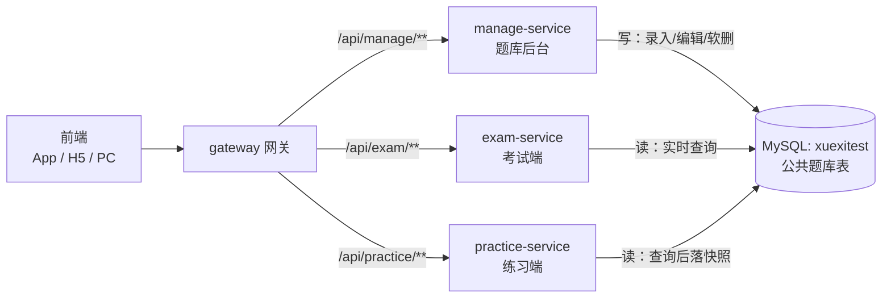
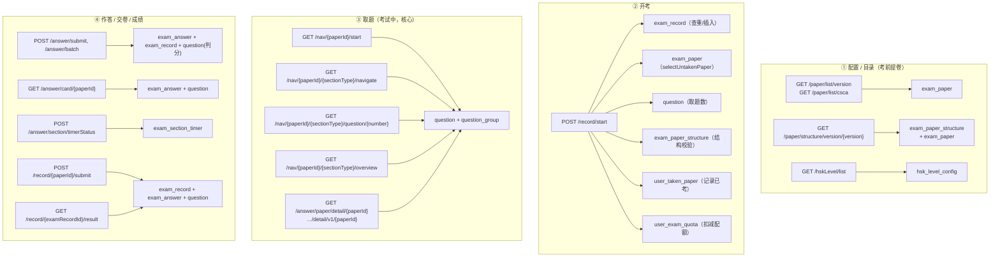
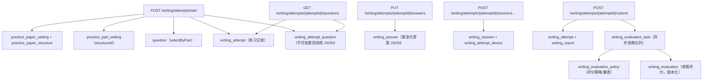
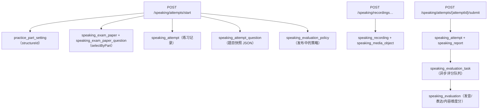

# HSK Treasure 题库数据流向梳理（练习题库 / 考试题库）

> 结论先行：本仓库**没有独立的"题库服务"**。`exam-service`、`practice-service`、`manage-service` 三个服务**直连同一个 MySQL 库 `xuexitest`**，共同读写同一批题库物理表。
> - **写入/维护**：`manage-service`（后台录入、Excel 导入、编辑、软删除）
> - **考试读取**：`exam-service`（实时查题库）
> - **练习读取**：`practice-service`（查题库 + 落"题目快照"隔离）
>
> 前端拿题目 = 调 `exam-service` / `practice-service` 的接口，服务端用 SQL 直接查 `question` / `question_group` 等公共题库表。

---

## 一、整体架构与访问链路

前端 → 网关（`gateway`）→ 各业务服务，路由规则（`StripPrefix=2`）：

| 网关路径 | 目标服务 | 端口 |
| --- | --- | --- |
| `/api/exam/**` | exam-service | 8084 |
| `/api/practice/**` | practice-service | 8087 |
| `/api/manage/**` | manage-service | 8085 |

数据源（三服务指向同一库 `xuexitest`，仅环境实例不同）：

| 服务 | 数据库 |
| --- | --- |
| exam-service | `xuexitest`（prod `43.99.57.11:3306` / test `124.227.194.80:184`） |
| practice-service | `xuexitest`（默认 `localhost:3306`，prod 覆盖） |
| manage-service | `xuexitest`（prod `43.99.57.11:3306` / test `8.138.185.11:3306`） |

---

## 二、公共题库表（核心，全服务共用）

这组表是"题目"的唯一真实来源，由 `manage-service` 维护，`exam-service` / `practice-service` 读取。

| 表名 | 作用 | 归属方（读/写） | 关键字段 |
| --- | --- | --- | --- |
| `exam_paper` | 试卷主表。题库的后台与练习端也都映射到本表（practice 侧实体 `PracticePaper` = `exam_paper`） | manage 写；exam/practice 读 | `id, version, level, exam_type(1=HSK,2=CSCA), source, subject_type, subject_type_mapping, language_version, description` |
| `question` | **题目主表**（前端最终拿到的"题"就是这条记录） | manage 写；exam/practice 读 | `id, paper_id, group_id, type_id, type_id_mapping, section, section_mapping, number, content, passage, option_content(JSON), answer, score, audio_url, title1_number, title1_text, difficulty, sort_order, deleted` |
| `question_group` | **题组/材料组**：多题共用一篇材料或音频（听力 material、阅读篇章） | manage 写；exam/practice 读 | `id, paper_id, type_id, type_id_mapping, section, start_number, end_number, passage, option_content(JSON), group_title, audio_url, sort_order` |
| `question_shared_audio` | 听力"共享音频"：一段音频覆盖某题号区间（`start_number`~`end_number`） | manage 写；practice 读 | `id, paper_id, group_id, audio_url, material_code, material_name, start_number, end_number, sort_order` |
| `hsk_level_config` | 等级配置（等级、时长、模块题量等），考试端与练习端都用 | manage/exam 写；practice 读 | 等级 ↔ 时长/题量配置 |
| `speaking_exam_paper` | 口语试卷主表 | manage 写；exam/practice 读 | `id, description, source, level, version, total_time` |
| `speaking_exam_paper_question` | 口语题目表 | manage 写；exam/practice 读 | `id, paper_id, number, question_group, question_type_mapping, passage, practice_audio_url, pic_url, level, reference_answer, audio_time, waitting_time, score` |

### 遗留/未启用表（重要提醒）

| 表名 | 状态 | 说明 |
| --- | --- | --- |
| `passage` | 仅有实体 `Passage.java`，**无任何 Mapper/XML 使用** | 篇章内容实际存在 `question.passage` / `question_group.passage`（字符串字段），该表未参与前端取题 |
| `question_option` | 仅有实体 `QuestionOption.java`，**无 Mapper/XML 使用** | 选项实际存在 `question.option_content` / `question_group.option_content`（**JSON 字段**），不是独立选项表 |

> 即：前端拿到的"选项"来自 `option_content` JSON，而不是 `question_option` 表。

---

## 三、考试题库数据流（exam-service）

### 3.1 关键特征：**实时读题库**

考试端每次取题都直接查 `question` / `question_group` 的当前值，**不落题目快照**（只有用户答案 `exam_answer` 落库）。因此考试中题目内容若被后台改动，前端会看到新内容。

### 3.2 数据流示意

### 3.3 接口 → 表 映射清单

| 功能 | 接口 | 读取/写入的表 |
| --- | --- | --- |
| 试卷列表（HSK） | `GET /paper/list/version` | `exam_paper` |
| 试卷列表（CSCA） | `GET /paper/list/csca` | `exam_paper` |
| 试卷结构/详情 | `GET /paper/structure/version/{version}?hskLevel=` | `exam_paper_structure`、`exam_paper` |
| 等级配置 | `GET /hskLevel/list` | `hsk_level_config` |
| **开考** | `POST /record/start` | 写 `exam_record`、`user_taken_paper`；读 `exam_paper`、`question`、`exam_paper_structure`；改 `user_exam_quota` |
| 开考（CSCA） | `POST /record/start`（exam_type=2 分支） | 同上 + `exam_paper.subject_type_mapping` |
| 考试中查询 | `POST /answer/queryExamInProgress` | `exam_record` |
| **第一题** | `GET /nav/{paperId}/start` | `question`（`selectFirstQuestion`）、`question_group`、`exam_answer`、`exam_record` |
| **上下题导航** | `GET /nav/{paperId}/{sectionType}/navigate` | `question`（`selectPrevQuestion` / `selectNextQuestion`）、`question_group`、`exam_answer` |
| **按题号跳转** | `GET /nav/{paperId}/{sectionType}/question/{number}` | `question`（`selectByPaperIdAndNumber`）、`question_group`、`exam_answer`、`exam_record` |
| 部分概览 | `GET /nav/{paperId}/{sectionType}/overview` | `exam_paper`、`question_group`、`question` |
| **试卷详情（含题+答案）** | `GET /answer/paper/detail/{paperId}` | `exam_paper` → `exam_paper_structure` → `question` / `question_group` → `exam_answer` |
| 试卷详情 V1（含例题） | `GET /answer/paper/detail/v1/{paperId}` | 同上，额外按 `type_id_mapping='example_question'` 查例题 |
| 试卷详情（CSCA） | `GET /answer/paper/csca/detail/{paperId}` | 同上 + `exam_paper_structure` 按 `subject_type_mapping` |
| 单题作答 | `POST /answer/submit` | 写 `exam_answer`；读 `question`（判分）、`exam_record` |
| 批量作答 | `POST /answer/batch` | 同上 |
| 答题卡 | `GET /answer/card/{paperId}`、`/card/detail/{paperId}` | `exam_answer`、`question` |
| 答题统计 | `GET /answer/statistics/{paperId}` | `exam_answer` |
| 交卷检查 | `GET /answer/checkSubmit/{paperId}` | `exam_answer`、`exam_record` |
| 题目标记 | `POST /answer/paper/tag` | `exam_answer.is_tag` |
| 分段计时 | `POST /answer/section/timerStatus` | `exam_section_timer` |
| **交卷** | `POST /record/{paperId}/submit` | 汇总 `exam_answer`，写 `exam_record`，读 `question` 判分 |
| 交卷（CSCA） | `POST /record/{paperId}/submit/csca` | 同上 |
| 成绩详情 | `GET /record/{examRecordId}/result` | `exam_record`、`exam_answer`、`question`、`question_group` |
| 单题结果 | `GET /record/{paperId}/question/{questionId}` | `question`、`question_group`、`exam_answer` |
| 考试记录列表 | `GET /record/user/records` | `exam_record`、`exam_paper` |
| 分数趋势 | `GET /record/user/scoreTrend` | `exam_record`、`exam_paper` |
| 中途退出 | `POST /record/{paperId}/leave` | `exam_record` |
| 成绩单 PDF | `GET /record/{examRecordId}/scoreReport` | `exam_record`、`exam_answer`、`question` |
| 准考证/场次号 | `GET /number/examTicket` | `exam_number` |
| 口语考试（独立一套） | `/speaking/structure`、`/quota`、`/start`、`/submitAnswer`、`/submitExam`、`/examResult`、`/questionDetail`、`/recordList` | `speaking_paper_structure`、`speaking_exam_level`、`user_exam_quota`、`speaking_exam_record`、`speaking_exam_answer`、`speaking_exam_paper(_question)` |

> 听力"共享音频"在考试端通过 `question_group.audio_url` 直接拿到；练习端才走 `question_shared_audio` 按 `group_id` 查。

---

## 四、练习题库数据流（practice-service）

练习端分 **听力 / 阅读 / 写作 / 口语** 四条线，共用一套"练习发布配置"，但取题来源与快照策略不同。

### 4.1 练习发布配置表（练习端专有）

| 表名 | 作用 | 关键字段 |
| --- | --- | --- |
| `practice_paper_setting` | 练习试卷展示设置（是否启用/可见/排序） | `paper_id(PK), enabled, visible, sort_order` |
| `practice_paper_structure` | **每个 Part 的发布配置**（决定前端看到几个部分、每部分题量/时长） | `id, paper_id, version, hsk_level, content_type(SEC_LISTEN/SEC_READ/SEC_WRITE/SEC_SPEAK), section_name, question_count, duration_minutes, sort_order` |
| `practice_part_setting` | **Part ↔ 题型/作答方式映射**（前端拿题目时的关联关键表） | `structure_id(PK), paper_id, section_mapping, section_code, type_code, type_name(_en/_vi), answer_mode(SINGLE/MATCH/ORDER), enabled` |
| `practice_module_level_config` | 模块等级配置（能力说明、标准题量、建议时长） | `version, level, section_mapping, total_question_count, suggested_duration_minutes` |
| `practice_user_preference` | 用户练习偏好（上次选的等级/试卷） | `user_id, section_mapping, last_level, last_paper_id` |
| `practice_question_option_pool` | **阅读配对/共享选项池**：哪些题共用哪一组选项 | `structure_id, question_id, pool_code` |

### 4.2 听力 / 阅读线（客观题，实时查题库 + 答案快照）

```mermaid
flowchart TD
    L1["GET /listening/levels<br/>/reading/levels"] --> P1["practice_module_level_config<br/>+ hsk_level_config"]
    L2["GET /{mod}/papers"] --> P2["exam_paper<br/>+ practice_paper_setting<br/>+ practice_paper_structure"]
    L3["GET /{mod}/papers/{paperId}/parts"] --> P3["practice_paper_structure<br/>+ practice_part_setting"]

    S1["POST /{mod}/records/start"] --> R1["practice_record（建记录）"]
    S1 --> R2["practice_paper_structure<br/>+ practice_part_setting"]
    S1 --> R3["question（selectByPart）"]

    Q1["GET /{mod}/records/{recordId}/questions"] --> R4["practice_paper_structure<br/>+ practice_part_setting"]
    Q1 --> R5["question（selectByStructure）"]
    Q1 --> R6["question_group（按 group_id）"]
    Q1 --> R7["question_shared_audio（听力，按 paper+group）"]
    Q1 --> R8["practice_question_option_pool（阅读）"]
    Q1 --> R9["practice_answer（已作答回填）"]

    A1["PUT /{mod}/records/{recordId}/answers"] --> W1["practice_answer（含 question_snapshot JSON）"]
    A2["GET /{mod}/records/{recordId}/answer-card"] --> W2["practice_answer + question"]
    A3["POST /{mod}/records/{recordId}/sessions…"] --> W3["reading_session<br/>+ reading_record_device"]
    A4["POST /{mod}/records/{recordId}/submit"] --> W4["practice_record + practice_answer<br/>+ practice_report"]
```

| 功能 | 接口 | 涉及表 |
| --- | --- | --- |
| 等级列表 | `GET /listening/levels`、`GET /reading/levels` | `practice_module_level_config`、`hsk_level_config` |
| 等级介绍 | `GET /{mod}/levels/{levelCode}/intro` | `practice_paper_structure`、`practice_paper_setting`、`exam_paper` |
| 练习偏好 | `GET /reading/preferences`、`PUT /reading/preferences/level` | `practice_user_preference` |
| 试卷列表 | `GET /reading/papers`、`GET /listening/papers/...` | `exam_paper`、`practice_paper_setting`、`practice_paper_structure` |
| Part 列表 | `GET /{mod}/papers/{paperId}/parts` | `practice_paper_structure`、`practice_part_setting` |
| **开始练习** | `POST /listening/records/start`、`POST /reading/records/start` | `practice_paper_structure`、`practice_part_setting`、`question`（`selectByPart`）、`practice_record` |
| **取题目** | `GET /listening/records/{recordId}/questions`、`GET /reading/records/{recordId}/questions` | `question`（`selectByStructure`）、`question_group`、`question_shared_audio`(听力)、`practice_question_option_pool`(阅读)、`practice_answer` |
| 保存答案 | `PUT /{mod}/records/{recordId}/answers/{questionId}`、`PUT /{mod}/records/{recordId}/answers` | `practice_answer`（写 `question_snapshot`/`option_snapshot`/`standard_answer_snapshot` JSON） |
| 答题卡 | `GET /{mod}/records/{recordId}/answer-card` | `practice_answer`、`question` |
| 暂停 | `POST /{mod}/records/{recordId}/pause` | `practice_record` |
| 会话计时 | `POST /reading/records/{recordId}/sessions`（含 heartbeat/end） | `reading_session`、`reading_record_device` |
| **提交** | `POST /{mod}/records/{recordId}/submit` | `practice_record`、`practice_answer`、`practice_report` |
| 报告 | `GET /{mod}/records/{recordId}/report`、`/report/questions/{questionId}`、`/parts/{structureId}/reports/latest` | `practice_report`、`practice_answer` |
| 报告重试 | `POST /{mod}/records/{recordId}/report/retry` | `practice_report` |

> 阅读/听力的取题目 SQL 关键点（`PracticeQuestionMapper.xml`）：
> - `selectByPart` / `selectByStructure` 都过滤 `deleted = 0`，并排除 `type_id_mapping = 'example_question'`（例题不进练习）
> - `selectByStructure` 的关联条件是 `question.paper_id + section_mapping + section` ↔ `practice_part_setting.paper_id + section_mapping + section_code`

### 4.3 写作线（**快照隔离**：开练即冻结题目）

| 表名 | 作用 |
| --- | --- |
| `writing_attempt` | 写作练习记录（含 `question_set_version` 冻结版本号、计时、幂等键） |
| `writing_attempt_question` | **不可变题目快照**：`public_snapshot`（答题端可见）+ `evaluator_snapshot`（阅卷端专用）。开练后题目不再随题库变化 |
| `writing_answer` | 写作草稿答案（`answer_json`、`server_version` 乐观锁、`matched_keywords`） |
| `writing_session` / `writing_attempt_device` | 会话计时 / 设备同步游标 |
| `writing_report` | 学习报告（分数、客观题统计、计时） |
| `writing_evaluation_policy` | 版本化评价策略（规则 `rule_json`、量表 `rubric_json`、提示词、模型） |
| `writing_evaluation_task` | 异步阅卷任务（租约 `lease_until`、重试） |
| `writing_evaluation` | 不可变单题评价（`current_version` 标记当前有效版本） |

### 4.4 口语线（**快照隔离**，源表与考试端口语不同）

| 表名 | 作用 |
| --- | --- |
| `speaking_attempt` | 口语练习记录（`config_version`、`question_source_version`、幂等键） |
| `speaking_attempt_question` | 口语题目快照（`public_snapshot` 给答题端，`evaluator_snapshot` 给评分端） |
| `speaking_recording` / `speaking_media_object` | 录音版本链（`is_current` 唯一）+ 媒体对象（预签名上传） |
| `speaking_session` / `speaking_attempt_device` | 会话计时 / 设备游标 |
| `speaking_report` | 口语报告（达成率、归一化均分、得分/满分） |
| `speaking_evaluation_policy` | 评分策略（维度权重、阈值、provider 配置） |
| `speaking_evaluation_task` | 异步评分任务 |
| `speaking_evaluation` | 不可变评分结果（`transcript`、发音/表达/内容分、评语） |

> 口语题库源表：`speaking_exam_paper`（试卷）、`speaking_exam_paper_question`（题目）。
> `SpeakingSourceQuestionMapper` 按 `question_type_mapping` 把题目归入 PART_1/2/3（如 `listen_repeat`/`story_retelling` → PART_1）。

---

## 五、后台题库管理数据流（manage-service）

后台是题库的**唯一写入方**，改的是第二、三节的公共题库表。

| 接口/入口 | 作用 | 涉及表 |
| --- | --- | --- |
| `QuestionBankController` | 题库检索（HSK 单题/听力/大题组、CSCA 分页、版本列表、学科类型列表） | `exam_paper` JOIN `question` / `question_group` |
| `QuestionController` | 题目增删改查、按试卷/题型批量软删 | `question`（`deleted=1` 软删除） |
| `QuestionGroupController` | 题组增删改查 | `question_group` |
| `SpeakingExamPaper*` | 口语试卷与题目维护 | `speaking_exam_paper`、`speaking_exam_paper_question` |
| `QuestionSharedAudioMapper` | 听力共享音频维护 | `question_shared_audio` |
| Excel 导入 | `QuestionExcelHskListener` / `QuestionExcelCscaListener` / `QuestionExcelSpeakingListener` | 导入 `question`、`question_group`、`speaking_exam_paper_question` |

题型分组逻辑（题库检索的 `UNION ALL` 三段式）：
1. 普通单题：`exam_paper` JOIN `question` 且 `q.group_id IS NULL`
2. 听力题：`exam_paper` JOIN `question` 且 `q.group_id IS NOT NULL` 且 `q.type_id_mapping LIKE 'listening%'`
3. 非听力大题组：`exam_paper` JOIN `question_group` 且 `qg.type_id_mapping NOT LIKE 'listening%'`

---

## 六、关键设计要点（避坑清单）

1. **单库共享，无题库服务**：三个服务直连 `xuexitest`，无跨服务 HTTP 取题。改动题库表结构会同时影响考试端、练习端和后台，必须三方同步评估。
2. **考试端"实时读"，练习端"快照隔离"**：
   - 考试端：每次取题都查 `question` / `question_group` 当前值 → 题面变更即时生效。
   - 练习端写作/口语：开始练习时把题目写入 `writing_attempt_question` / `speaking_attempt_question`（JSON 快照）→ 练习过程与报告不受题库改动影响。
   - 练习端听力/阅读：题目实时查，但用户答案 `practice_answer` 里存 `question_snapshot` / `option_snapshot` / `standard_answer_snapshot` 快照用于报告复盘。
3. **例题隔离**：所有面向考生的取题 SQL 都排除 `type_id_mapping = 'example_question'`；只有 `GET /answer/paper/detail/v1/{paperId}`（和考试端例题逻辑）会单独查例题。
4. **选项在 JSON 里**：`question.option_content` / `question_group.option_content`，`question_option` 表是遗留空壳，不要往那写。
5. **篇章在字符串字段里**：`question.passage` / `question_group.passage`，`passage` 表是遗留空壳。
6. **逻辑删除**：几乎所有查询都带 `deleted = 0`；后台删题走软删除（`deleted = 1`）。
7. **两个 `paper_structure` 不要混**：
   - 考试：`exam_paper_structure`（考卷结构，按 version + hskLevel）
   - 练习：`practice_paper_structure`（练习 Part 发布配置，按 `content_type = SEC_LISTEN / SEC_READ / SEC_WRITE / SEC_SPEAK`）
8. **两套口语表不要混**：
   - 考试端口语：`speaking_exam_record` / `speaking_exam_answer` / `speaking_exam_level` / `speaking_paper_structure`
   - 练习端口语：`speaking_attempt*` / `speaking_report` / `speaking_evaluation*`（题目源仍取 `speaking_exam_paper_question`）
9. **听力共享音频**：一段音频多题共用 → `question_shared_audio.group_id` 关联 `question_group`；练习端用 `selectByPaperAndGroup` 批量取，考试端直接用 `question_group.audio_url`。

---

## 七、速查：前端"取题"应该查哪张表

| 场景 | 前端接口 | 题面来源表 | 选项来源 | 用户答案表 |
| --- | --- | --- | --- | --- |
| 考试（HSK/CSCA）取题 | `GET /api/exam/nav/**`、`GET /api/exam/answer/paper/detail/{paperId}` | `question`（+ `question_group`） | `option_content` JSON | `exam_answer` |
| 考试交卷/成绩 | `POST /api/exam/record/{paperId}/submit`、`GET /record/{examRecordId}/result` | `question` + `question_group` | `option_content` JSON | `exam_answer` |
| 练习·听力取题 | `GET /api/practice/listening/records/{recordId}/questions` | `question` + `question_group` + `question_shared_audio` | `option_content` JSON | `practice_answer` |
| 练习·阅读取题 | `GET /api/practice/reading/records/{recordId}/questions` | `question` + `question_group` | `option_content` JSON + `practice_question_option_pool` | `practice_answer` |
| 练习·写作取题 | `GET /api/practice/writing/attempts/{attemptId}/questions` | `writing_attempt_question`（快照）← 源 `question` | 快照内 JSON | `writing_answer` |
| 练习·口语取题 | `GET /api/practice/speaking/attempts/{attemptId}/questions` | `speaking_attempt_question`（快照）← 源 `speaking_exam_paper_question` | 快照内 JSON | `speaking_recording` + `speaking_attempt_question` |
| 后台录入/编辑题库 | `/api/manage/question/**`、`/api/manage/question_bank/**` | `question` / `question_group` | `option_content` JSON | — |

---

*文档基于仓库当前代码静态梳理（控制器、Service 实现、MyBatis Mapper XML、建表脚本），未连接运行库验证。若表结构有变更，请以库内实际 DDL 为准。*
